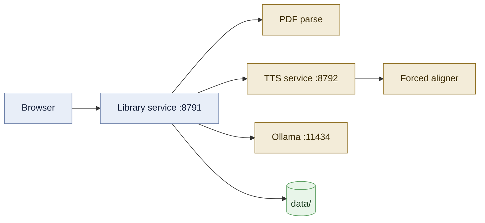

<div align="center">

# 📖 Lectern

**Read English books in a voice you cloned yourself — entirely on your own Mac.**

Word-by-word highlighting from forced alignment, in-context glosses for hard words,
and a full sentence translation beside the text. No cloud, no API keys, nothing leaves the machine.


</div>

---

## What it is

Point it at a folder of PDFs. It parses them into one clean stream of prose, reads a book
aloud sentence by sentence in a voice you provide, lights up each word exactly as it is
spoken, and shows what the hard words mean — all computed locally.

The three models that make it work all run on your machine:

| Job | Model | Runs on |
|---|---|---|
| Speech | Qwen3-TTS 1.7B Base (bf16), zero-shot voice cloning | MLX, Apple Silicon |
| Word timings | Qwen3-ForcedAligner 0.6B | MLX |
| Glosses & translation | Your Ollama model of choice | Ollama |

Glosses and translations come out in whatever language you set `gloss_lang` to. It defaults
to **English**, so out of the box you get English-to-English definitions — the kind a B2–C1
reader wants. Set it to `简体中文`, `Español`, `Deutsch` or anything else your Ollama model
handles and the reader switches with it.

## Features

| | |
|---|---|
| 📚 **A library of thousands of PDFs** | Scans folders recursively: title, author, table of contents, body text, generated cover. Serial scan, skips unchanged books, resumable |
| 📄 **Clean continuous prose** | Whatever the original layout, the whole book becomes one text flow: paragraphs split across pages are rejoined, hyphenation repaired, real compound hyphens kept. Paragraph rules are derived per book from its own leading, indent and margins — nothing hard-coded |
| 🎙️ **Read aloud in your voice** | A ~30s clean recording is all a voice takes. Each word lights up as it is spoken (real forced-alignment timings, not estimates); text glides with the audio instead of jumping a paragraph at a time |
| 🤔 **Thinking pauses** | A configurable silence after each sentence (default 10s). Nothing on screen moves, no countdown. ↑/↓ adjusts by 10s |
| 🈶 **In-context glosses** | Hard words in the current sentence are marked against the exact span of the translation they correspond to — the server verifies the span really occurs in the translation before showing it |
| ⚡ **Background pre-generation** | Audio, word timings and translations for the chapter are prepared ahead of playback. Audio is cached permanently per voice and sentence |
| 🧭 **Chapter guides** | A local model writes a synopsis, the characters, passages worth slowing down for, and hard expressions |
| 📊 **Reading time** | Per book and per day, with the share that was read aloud |
| 🕸️ **Character / concept maps** | Built up to the chapter you have reached, so nothing is spoiled. Names pulse as they are read |
| 🔒 **Local, fully** | PyMuPDF + an offline dictionary + MLX cloning + Ollama. No cloud API anywhere in the path |

> Scanned PDFs with no text layer can be catalogued but not read aloud.

## Architecture



| Part | Does | Where |
|---|---|---|
| Library service (FastAPI, `.venv`) | Routing and pages, read/translate scheduling, per-chapter pre-generation. One long job at a time | `library/web.py`, `busy.py` |
| PDF parsing | Metadata, TOC (inferred from type size when there are no bookmarks), cover; headers/footers stripped, whole book joined into one line flow, then split into paragraphs by that book's own layout. Versioned — books re-parse when the rules improve | `library/extract.py`, `scan.py` |
| Sentence splitting | One rule set, server-side only. Abbreviations, initials, a.m./p.m. and decimals don't split; `…?" he asked.` doesn't either | `library/text.py` |
| Dictionary & phonetics | ECDICT glosses + lemmatisation; CMUdict ARPAbet → stressed US IPA | `library/dictionary.py`, `phon.py` |
| TTS service (`.venv-tts`) | Zero-shot cloning from your reference clip; sentences arriving together are batched (up to 4) and loudness-matched; the aligner returns per-word start/end | `tts/server.py` |
| Ollama | Sentence translation, gloss-to-translation span alignment, chapter guides | `127.0.0.1:11434`, models in `library/config.py` |

A sentence from cold to playing: **scan** → **split** → **translate** → **speak + align** → **pre-generate ahead** → **play**. Audio cache filenames embed a voice fingerprint (model + reference audio + reference text), so changing a voice invalidates exactly the right entries.

## Quick start

Requires **Apple Silicon** (MLX), Python 3.11+, and [Ollama](https://ollama.com) running locally.

```bash
bash setup.sh              # .venv + dependencies
bash tools/setup_tts.sh    # .venv-tts + mlx-audio + ~4 GB of models
bash start.sh              # http://127.0.0.1:8791
```

Then add a voice (see below), point the library at a folder, and scan:

```bash
.venv/bin/python -m library sources ~/Books
.venv/bin/python -m library scan
```

Configuration lives in `data/config.json`:

| Key | Default | Does |
|---|---|---|
| `gloss_lang` | `English` | Language of translations and word glosses. `English` gives English-to-English definitions |
| `model` | a Qwen instruct model | Translation and glossing |
| `guide_model` | a larger Qwen | Chapter guides |
| `sources` | — | Folders to scan for books |
| `port` | 8791 | Web UI |

Environment: `LIBRARY_DATA`, `LIBRARY_PORT`, `LECTERN_VOICE`, `LECTERN_MODEL`, `LECTERN_PORT`.

> The UI is English throughout. Code comments are still Chinese, and translation quality for
> non-English `gloss_lang` values has not been measured yet.

## Bring your own voice

**This repository ships no cloned human voices.** The catalogue in `tts/voices.json` contains
only synthetic child voices generated from text descriptions, plus one placeholder entry for
a recording you make yourself. That is deliberate: a cloned voice is a person's voice, and
distributing one is not ours to do.

Recording your own takes a minute:

```bash
# 1. Record ~40 seconds of yourself reading anything, clean and uninterrupted.
# 2. Install it:
.venv-tts/bin/python tools/add_voice.py mine ~/path/to/your-recording.wav
```

The tool trims the clip, normalises format and loudness, transcribes it with Qwen3-ASR,
and generates a sample to listen to. No restart needed. Check the generated `ref.txt` —
transcription errors hurt cloning quality.

| Task | Command |
|---|---|
| List the catalogue and what's installed | `tools/add_voice.py --list` |
| Install from a file, picking a span | `tools/add_voice.py <id> <file> --from 0:37 --to 1:03` |
| Noisy old recording | add `--denoise` |
| Music under the voice | add `--separate` (demucs, in its own `.venv-sep`) |

Add your own entries to `tts/voices.json` to make them selectable in the reader. Only clone
voices you have the right to clone — your own, or ones you have permission for.

## Notes as readable documents

Markdown dropped into `research/` is rendered at `/research` (tables, SVG, mermaid) and can
be pushed into the reader with one click, read sentence by sentence like a book — table rows
become sentences, images read their captions, code blocks are skipped. Nothing in that folder
is tracked by git.

## License

MIT. See [LICENSE](LICENSE).
