# 数据模型

> 行数与体积来自 2026-10-17 对 `data/*.db` 的 `dbstat` 统计（含索引页），只列主键和关键列；完整列定义在 `library/db.py`、`library/schemas/*.py`、`library/search.py`、`library/similar.py`。

## 0. 七个库一览

| 库 | 体积 | 结构版本 | 日志模式 | 写入方 | 主要读取方 | 可再生？ |
|---|---|---|---|---|---|---|
| `library.db` | 评审时 674 MB；2026-10-17 摘要分库并 VACUUM 后 118 MB | user_version 4（`db.py`） | WAL | 网站进程（阅读、朗读、预生成）、扫描进程 | 阅读页、书架、书城（查在不在库） | 书目可重扫；进度、导读、译文缓存、人物、对白、阅读时长不可再生 |
| `digest.db` | 608 MB | 无（`digest.py`） | WAL | 扫描 / 入库（经 library.db 的连接 ATTACH 为 `dg`） | 去重比对、模型分类、确认页、质量体检 | 可再生（打开 / 扫描时重算） |
| `catalog.db` | 162 MB（空闲页 45.8 MB，28%） | 4（`schemas/catalog.py`） | WAL | 编目、去重、enrich、exclude（删行） | 书城（只读）、扫描、书目层、搜索索引、向量 | 可重建（编目几分钟；enrich 联网部分慢） |
| `biblio.db` | 61 MB（+WAL 9.1 MB） | 6（`schemas/biblio.py`） | WAL | 书目层各模块，每表一个写入方 | 书城、搜索索引、向量、口味 | 联网来源与人工决定（`same_book_review`、`tr_review`、`cover_reject`、`translations_manual`）不可再生 |
| `search.db` | 122 MB（空闲 8.8 MB） | 0 | delete | `library.search build`（整库重建后改名替换） | 书城搜索与联想 | 可重建（几十秒） |
| `similar.db` | 187 MB | 0 | WAL | `library.similar embed / neighbours` | 书城详情「相似的书」、译本候选、「和你的工作相关」 | 可重建但要数小时 |
| `exclude.db` | 2.9 MB | 1（`schemas/exclude.py`） | WAL | `library.exclude` | 编目（拦截）、排除规则 | **不可再生**（人工决定） |
| `dict.db` | 24.7 MB | 0 | delete | `tools/build_dict.py` 一次性生成 | 难词挑选、音标、语调音节 | 可由 ECDICT + CMUdict 重建 |

## 1. library.db（阅读与朗读）

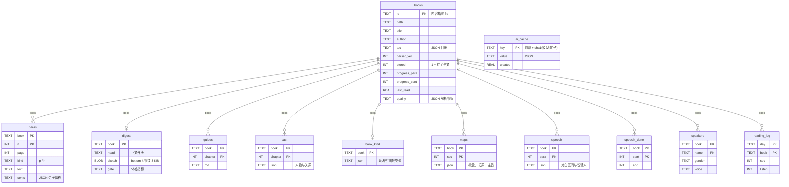

| 表 | 用途 | 量级（实测） | 写入方 | 读取方 | 备注 |
|---|---|---|---|---|---|
| `books` | 书目、解析状态、阅读进度 | 34,308 行、96.5 MB（每行 2.8 KB，`toc` 平均 1.4 KB） | `scan.save_book / mark_error`，`reader.progress`，`shelf` | 处处 | 索引：path、title、author、added、last_read |
| `paras` | 读过的书的段落正文 + 句子偏移 | 5,966 行、4 本书、3.2 MB | `save_book`（一本书一个事务） | `/text`、预生成、人名表、人物抽取 | `WITHOUT ROWID`，主键 (book, n) 直接支持范围扫描：40 段 0.02 ms，整本 0.73 ms |
| `digest`（版本 4 起在 `digest.db`） | 每本书的开头、bottom-k 指纹、体检指标 | 评审时 34,317 行、548 MB（占 library.db 81%）；现 38,7xx 行在 digest.db | `save_book`（经 ATTACH） | 去重比对、模型分类、确认页、质量体检 | 阅读路径从不读它；SQL 里不带前缀的 `digest` 自动落到 `dg.digest` |
| `ai_cache` | 整句译文 + 难词（`t3:`）、难点讲解（`n1:`）、中文讲解（`z1:`） | 2,108 行（版本 4 删掉了旧前缀 `t:`、`t2:` 的 795 行） | `narrate.cached_ai` | `/translate`、`/notes`、预生成 | 键含模型名，换模型自动失效 |
| `guides` | 章节导读 Markdown | 0 行 | `guide._write_guide` | 书页 | 备份保留 |
| `cast` | 按章抽的人物与关系 | 3 行（1 本） | `cast.extract` | `/cast`、对白归属 | |
| `book_kind` | 书的读法：mode = en 外文 / wy 文言 / zh 白话，map = people / concepts，文言句比例，谁定的（规则 / 模型） | 一本一行 | `bookkind.ensure`（阅读页后台准备、预生成） | 阅读页 `B.mode`、`/api/translate`、`/map` | |
| `maps` | 概念导图：按二级目录小节抽的概念（people 形状，role 是解释、kind 是概念 / 方法 / 观点…）、关系、主旨 | 每节一行 | `concepts.extract` | `/map` | |
| `speech` / `speech_done` / `speakers` | 对白归属、已归属范围、人物性别与音色 | 0 行（功能刚上线，尚未跑过一章） | `speech.attribute / ensure / assign` | `/text`、朗读计划 | |
| `reading_log` | 按（日, 书）累计阅读秒数 | 1 行 | `readtime.add_time` | 书架、统计页 | |
| `books_fts` | 旧的书名 / 作者全文索引 | 已在版本 4 删除 | — | — | — |

## 2. catalog.db（编目）

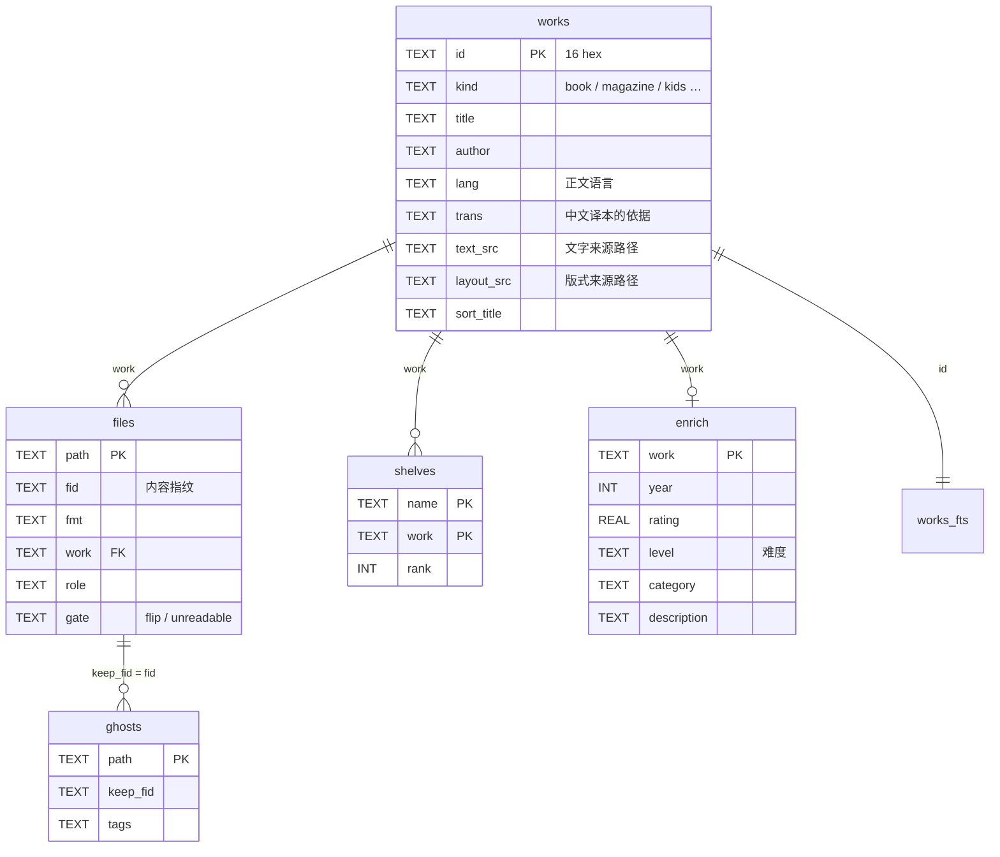

| 表 | 用途 | 量级 | 写入方 | 读取方 |
|---|---|---|---|---|
| `files` | 每个文件一行：格式、指纹、元数据、所属作品 | 39,170 行、22 MB（+ 主键索引 9.4 MB） | `catalog.scan / rebuild`，`set_gate`（扫描、体检），`exclude`（删行） | 书城视图、扫描（文字来源）、书目层、去重 |
| `works` | 作品：多格式归并后的一本书 / 一期刊 | 39,051 行、18 MB | `catalog.rebuild`，`dedupe` | 书城、扫描、搜索、向量 |
| `shelves` | 目录名推出的货架 / 榜单 → 作品 | 135,733 行、6.2 MB | `catalog` | `ShelfIndex`（整表进内存） |
| `ghosts` | 去重移走的文件及其货架标签 | 54,370 行、18 MB（+ 索引 13.6 MB） | `dedupe` | `catalog.rebuild` |
| `enrich` | Open Library 书目、难度分级、旧的单级类别 | 18,115 行、9.3 MB | `enrich`，`dedupe` 迁移 | 书城视图 |
| `works_fts` | 作品名 / 作者 FTS5 | 39,051 文档 | `catalog` | 书城列表（搜索时） |

**书城分栏（英文书 / 中文书 / 译文 / 其他语种）**：分栏看正文，不看书名。两步：编目时 `catalog.lang_of` 判正文语言写进 `works.lang`，`catalog.trans_cue` 给中文正文的书记下「看得出是外国作品译本」的依据写进 `works.trans`；书城物化视图建表时再并进书目库的信号，算出 `wv.tab`。首页、列表、分面、货架归栏都只按 `wv.tab` 筛；「为你」和「相似的书」仍按正文语言分中、英两边。判定规则改了就提高 `CATALOG_VER`，下次编目全部重判（约 4.9 万个文件、18 分钟），物化视图随 catalog.db 的修改自动重建。

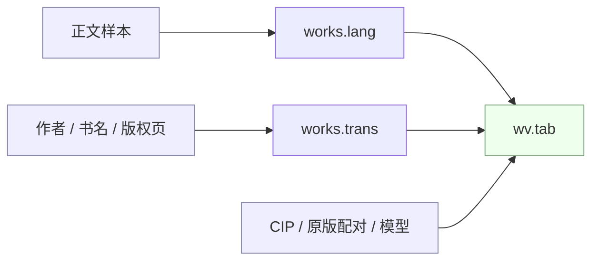

正文语言（`works.lang`）按顺序判：

| 顺序 | 情况 | 结论 |
|---|---|---|
| 1 | 假名 ≥ 200 且占汉字加假名四分之一以上 / 韩文字母为主 / 西里尔字母为主 | 日文 / 韩文 / 俄文 |
| 2 | 正文样本（epub 全书、mobi 30 条记录、pdf 7 页、txt 全文均匀 4 段）汉字加字母不到 200 个 | 跳到 6 |
| 3 | 中英对照：字母数在汉字数的 1–7.5 倍之间（一个汉字约合 2.5 个字母，两种文字各占约四分之一以上） | 书里标着中文 → 中文；否则放在名字带「英文 / English」的目录里 → 英文；都不是 → 4 |
| 4 | 汉字 × 2.5 ≥ 字母数 | 中文 |
| 5 | 拉丁字母为主 | 按虚词分：某种外语（法、德、西、意、葡、荷）的虚词是英语的 3 倍以上 → 那种语言；虚词太少看不出 → 书里的语言标记（中文标记除外），没有就英文 |
| 6 | 没有正文样本（扫描版、取不到文字） | 标着英文且书名有两个以上英文单词 → 英文；在英文书目录里 → 英文；书名有汉字 → 中文；否则用标记，没有就英文 |

分栏（`wv.tab`）：

| 正文语言 | 条件 | 分栏 |
|---|---|---|
| 英文 | — | 英文书 `en` |
| 中文 | CIP 分类号在中国文学（I2） | 中文书 `zh` |
| 中文 | `works.trans` 有依据，或 CIP 在外国文学（I3–I7）、CIP 写着原书名、和书库里的外文原版配上了对（`translations`）、本地模型给的原著语言不是中文（`tr_llm`，或 `zh_origin` 里有把握的回答） | 译文 `tr` |
| 中文 | 以上都没有 | 中文书 `zh` |
| 其他 | 该语种的书够 20 本 | 单列一栏（日文书、法文书…） |
| 其他 | 不够 20 本 | 其他语种 `other` |

`works.trans` 的依据（`catalog.trans_cue`，按顺序取第一个）：

| 依据 | 说明 |
|---|---|
| 国籍 | 作者、文件名或书名里的外国国籍标记：「[美]」「【日】」「（英）」；「（清）」「[宋]」「[中]」这类中国朝代、国别不算 |
| 音译人名 | 作者名里汉字之间有间隔号：「赫尔曼·梅尔维尔」「乔治·R·R·马丁」「艾琳.亨特」 |
| 译者 | 署名里带译者：「吉本芭娜娜;张唯诚译」 |
| 版权页 | 正文开头 3000 字里有「译者：」「原书名：」「Simplified Chinese translation」等；书里引用的「××译，商务印书馆」不算；「图字」港台中文原创也有，不算 |
| 译丛 | 书名、文件名里有「译丛」「名著名译」「汉译」「全译本」 |
| 外文作者名 | 中文正文的书，作者名全是外文 |
| 同作者 | 同一作者的中文书多数（至少两本）看得出是译本时，其余的也算：「村上春树」「毛姆」有的文件带国籍、有的不带 |

编目和书目信号都没有的中文书（「中文书」栏里拿不准的那些，约 9,400 本）由 `python -m library.origin` 逐本问本地模型：给书名、作者、文件名和正文开头 800 字，问是中文原创还是外国作品的译本、原著什么语言，答案存进 biblio.db 的 `zh_origin`（`lang`、`sure`、`why`）。只认有把握（`sure=1`）且不是 `zh` 的，归进译文；问过的不再问（`--all` 重问）。用 gpu 锁，字幕 / 总结队列在跑时停下（`--wait` 就等）。上线前按 CIP 抽查：中国文学 40 本全答中文原创，外国文学 40 本 39 本答译本。2026-10-17 全量问了 9,407 本（平均 0.9 秒一本，超时的 77 本重跑补上）：有把握是译本 684 本（英文 343、日文 233、德文 33、韩文 15、法文 15、俄文 13，其余意、西、瑞典等），中文原创 8,656 本，没把握 67 本；中文书 10,179 → 9,493 本，译文 9,716 → 10,402 本。

语言标记 `cn`、「简体中文」「中文」都按 `zh`；`und` 之类当作没有。英文书目录只看书库根目录以下的各级目录名。

2026-10-17 两次重判：第一次（`CATALOG_VER` 8）把《母亲集》等 61 本国内出版的中英对照本归到中文，「英文原著专区」的中英对照 txt 章节、扫描版分级读物等 60 本归到英文；第二次（版本 9）按上面的规则拆出「译文」和「其他语种」：英文书 19,353 → 19,330 本，中文书 19,898 → 10,179 本，新增译文 9,716 本、其他语种 26 本（西班牙文 7、法文 6、德文 4、意大利文 3、葡萄牙文 3、日文 3）。书单、榜单在有 3 本以上的每一栏各出一行，只摆这一栏的书（以前整个书单按多数归一栏，「豆瓣读书 Top 250」里的译本跟着进了中文书）。

已知漏判：维吾尔族等带间隔号的中国作者（「尼格买提·热合曼」）会进译文（编目的依据先算，模型只问没有依据的书）。

## 3. biblio.db（书目层）

按写入模块分四张图。全部以 `fid`（文件指纹）为键，不改 catalog.db。

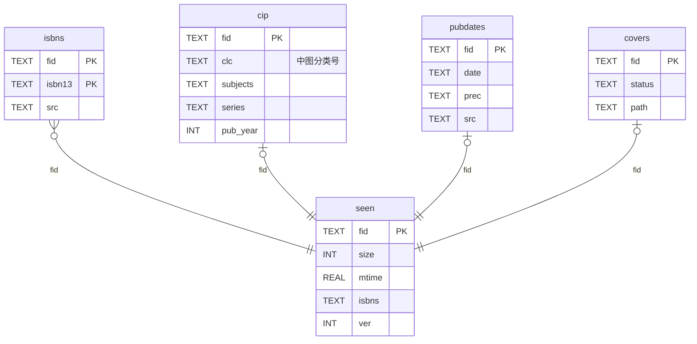

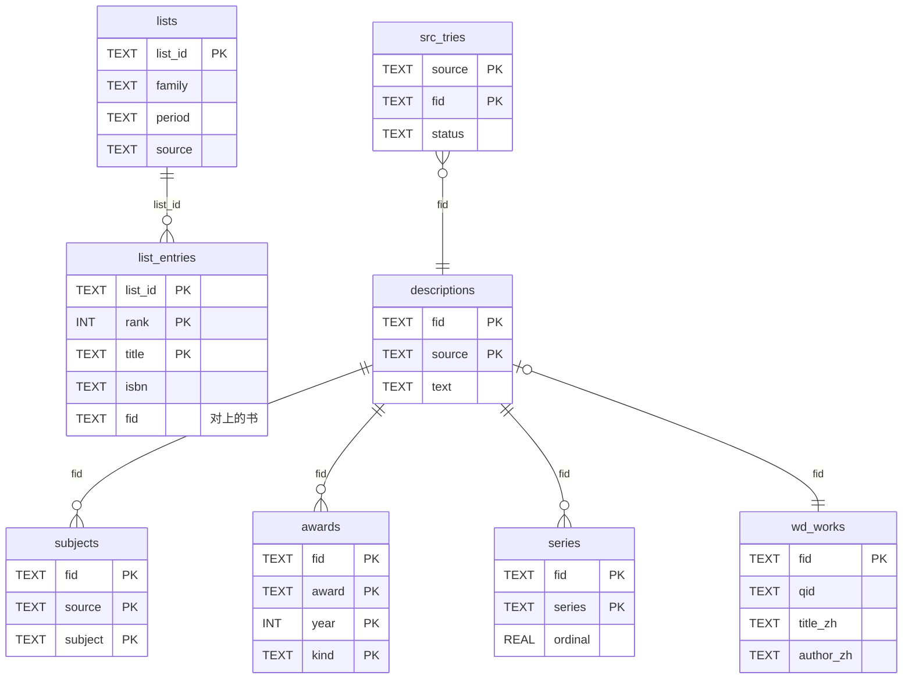

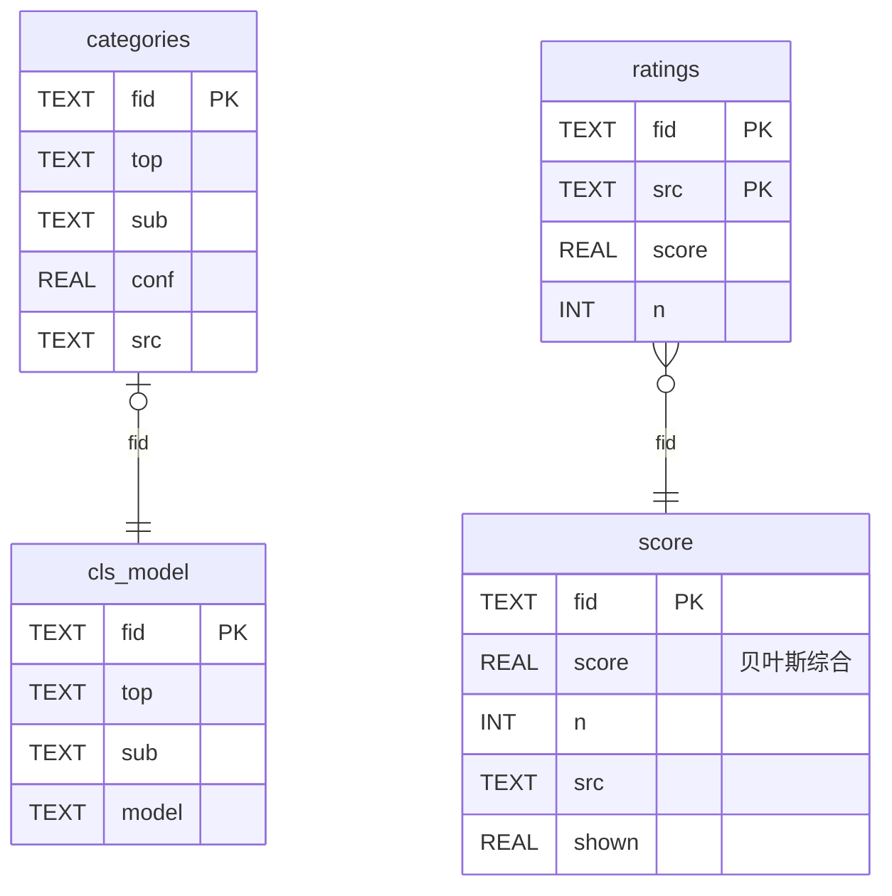

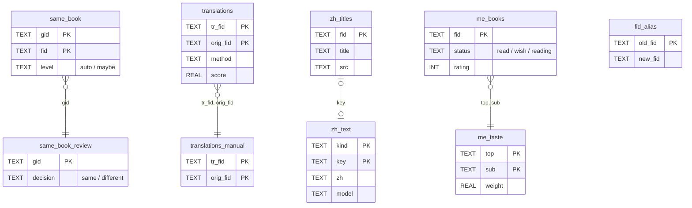

| 表组 | 表（行数） | 写入模块 | 读取方 |
|---|---|---|---|
| 书目层 | `seen` 36,573、`isbns` 25,125、`cip` 2,936、`pubdates` 21,253、`pub_tries` 26,289、`arrivals` 15,599、`covers` 83、`cover_reject` 25 | `biblio`、`pubdate`、`covers` | 书城视图（cip、pubdates）、封面路由 |
| 外部来源 | `descriptions` 5,297、`subjects` 75,327、`awards` 473、`series` 448、`wd_works` 1,022、`wd_zh_cn` 492、`first_pub` 2,688、`lists` 264、`list_entries` 1,386、`src_tries` 23,378 | `sources/*` | `Extras`（榜单、获奖、系列进内存）、详情页按需查 |
| 分类与口碑 | `categories` 29,764、`cls_model` 24,997、`ratings` 25,605、`score` 20,753、`tries` 44,440 | `classify`、`ratings` | 书城视图（categories、score） |
| 关联与口味 | `same_book` 372、`same_book_review` 161、`translations` 332、`translations_manual` 37、`translations_block` 2、`tr_llm*` 3,823 / 583 / 71、`tr_review` 59、`zh_titles` 403、`zh_text` 8,424、`me_books` 335、`me_authors` 55、`me_taste` 79、`fid_alias` 512、`zh_origin`（版本 7） | `match`、`review`、`translations`、`zh`、`taste`、`dedupe`、`origin` | 书城（译本按钮、中文名、主题词译文、「译文」分栏）、书架「为你」、相似书排除 |

## 4. search.db、similar.db、exclude.db、dict.db

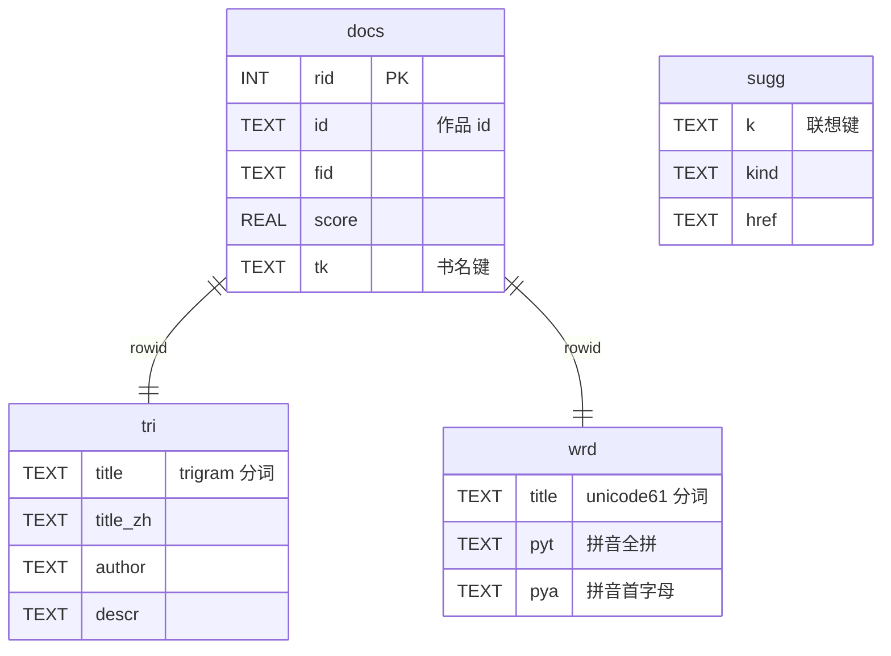

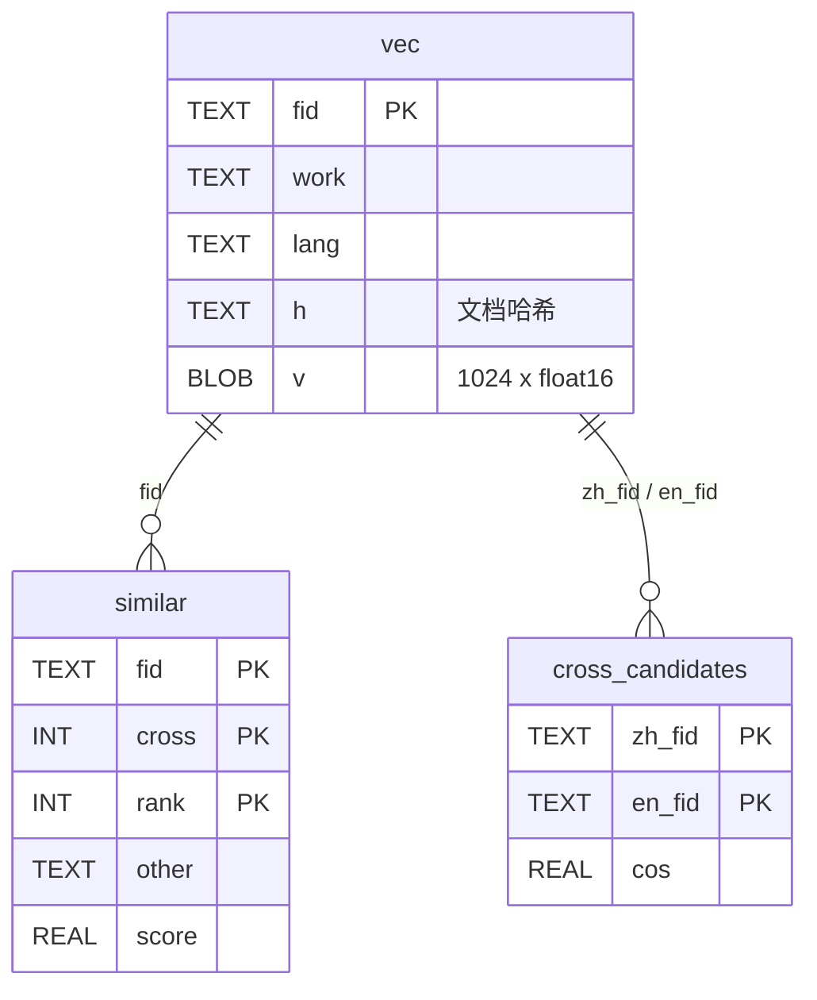

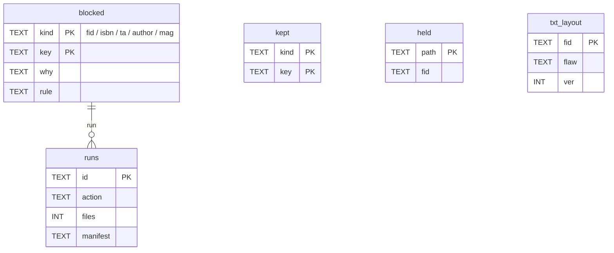

| 库 / 表 | 量级 | 说明 |
|---|---|---|
| `search.docs / tri / wrd / sugg` | 39,821 文档；`tri_data` 34.8 MB、`sugg` 154,035 行 19.6 MB | 查询实测：FTS 命中 0.2–0.3 ms；一两个字的中文词走 `docs` 短字段子串扫描 10.8 ms；联想 0.2 ms |
| `similar.vec / similar / cross_candidates` | 37,707 向量（155 MB）、288,375 邻居、249 候选译本 | 邻居计算在内存里做矩阵乘（float16 → numpy） |
| `exclude.blocked / kept / held / runs` | 14,242 / 248 / 0 / 4 | 不可再生；备份工具整库拷贝 |
| `dict.words / forms` | 118,377 / 80,600 | 只读；进程启动时把全部词表读进内存 26 ms |

**「质量」排除规则（宁缺毋滥）**：是入库门禁的一部分——`python -m library.exclude gate [--since 秒] --apply` 连同「扫描版」直接执行，不看 config、不用复核，新书入库（`tools/ops/new-books.sh` ③′，见 flows.md）每次都跑；也可以在 config.json 的 `exclude` 里写 `质量`，跟其他规则一起 `plan` 报出、`review --apply` 执行。文件都移到废纸篓，可 `undo`。和「扫描版」一样只把这份文件的指纹记进 `blocked`，同一本书以后排版好的版本照常进来。判定在 `exclude.quality_of`，看书城展示那份文件和入库体检指标（digest.db 的 `gate`、library.db 的段数）：

| 原因 | 条件 | 不算的 |
|---|---|---|
| 没有可读文件 | 作品没有文字来源也没有版式来源：加密的 epub（「[精品]」一批，容器文件是密文）、标了读不出的 mobi、没转换的 azw3 | — （新书流程先体检转换 azw3 再过门禁） |
| Office 文档 | 文件全是 doc / docx / chm（书单、求书清单、菜谱片段） | — |
| txt 章节碎片 | 只有 txt，书名是编号：「01」「b15」「bill 008」「volume01」「0101」「content」 | 单词书名（Inferno）、四位年份（1984） |
| 网络资料包 | 书名或文件名是营销论坛、资料合集：「市场营销书籍集萃」「世界知名公司经营智慧」「66顺营销论坛」「sicang8」 | 盗版商家留的「威信」「客服」「得道混顿」（底下常是正规书） |
| 试读残缺（书名） | 书名带「试读本」「PDF试读」「样章」「免费章节」「抢先版」「-连载」 | 「试读者手记」这类正常书名 |
| 排版差 | 四样都占：没有真封面（`exclude.covered`，和 `/store/cover` 同一口径）、没有评分、没有出版迹象（biblio 的 ISBN / CIP / 出版日期 / 豆瓣条目 / 简介 / Wikidata / 榜单 / 同书 / 译本，正文开头结尾的版权页）、txt 排版差（`txt.layout_flaw`：中文几乎没有标点、三成以上的字在没分段的大块里、五行以上网站水印、中文用半角标点）。结论按指纹缓存在 `exclude.txt_layout` | 只是没有封面的书 |
| 几乎没有内容 | 全书不到 5000 字 | 绘本、漫画、插画、童话、儿童类、多页的图画书 pdf、有评分的书 |
| 试读残缺 | 体检看出试读页、缺章 | — |
| 认不出字 | 中文常用字比例 < 0.7；西文像单词的词元 < 0.5（扫描识别、pdf 单词粘连） | 繁体书、古籍（0.8–0.95 是正常的） |
| 乱码或字间空格 | 「�」超过 1%，或两成以上的汉字之间有空格 | — |
| 碎片化 | 西文书一半以上段落只有一两个字、平均每段不到 15 字 | — |

整本书只解析出一两段的（多是 txt）不排除：原文件有段落，是解析器的问题。2026-10-18 已修：txt 改为按原文件的行、空行、缩进分段（`library/txt.py`，txt 单独的解析器版本 3），受影响的 1,211 本 txt 段数 8,678 → 1,201,193（中位数 1 → 579），全部 1,706 本 txt 162,549 → 2,075,743；同样症状的 36 本 epub/mobi/pdf（中文首行缩进写成全角空格、中文句末不认、零段距的书被当成按段间距分段、`<pre>` 的空行被吞）952 → 73,467。仍是一两段的 2 本原文件就没分段（calibre 由 txt 转的 epub 整章一个 `
`），另有 9 本这样的副本已在 10-18 去重时换成了别的版本。2026-10-17 第一次执行：排除 2,861 部、移走 2,925 个文件（6.6 GB；txt 章节碎片 1,942、几乎没有内容 398、没有可读文件 215、网络资料包 151、认不出字 149、其他 6），英文书 19,330 → 17,128，中文书 9,493 → 8,941，译文 10,402 → 10,295；清单在 logs/exclude-20261017-221355.txt、exclude-20261017-221446.txt。同日存量全查（`tools/quality_gate.py --apply` 再 `exclude gate --apply`）：清掉 2,609 条文件已移走的失效记录（「文件已不在」只删记录，不记进排除名单——改名、移走不等于文件坏），41 本图像书转成可翻阅的 PDF，28 本 calibre 重转、9 本重新入库，「扫描版」排除 154 部（6.6 GB）；之后门禁全查为 0（7 部在读、豆瓣记录等受保护的扫描版留着）。各栏：英文书 16,986、中文书 8,932、译文 10,293。2026-10-21：「没有可读文件」去掉 azw3 例外，排除 120 部（124 个文件、1.9 GB，logs/exclude-20261021-215453.txt）；加「排版差」，排除 3,673 部（2.3 GB；殆知阁无标点古籍 3,426、没分段 153、网站水印 67、半角标点 24、书名试读 3；logs/exclude-20261021-223019.txt）。

## 5. 跨库关联键

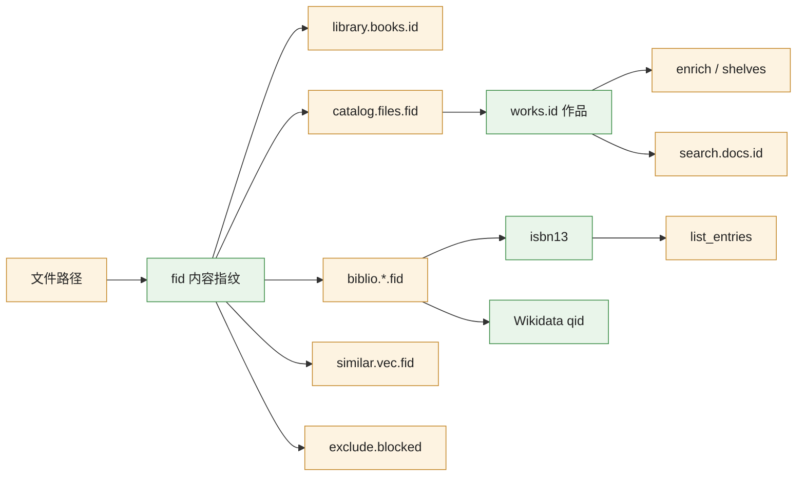

| 键 | 定义 | 谁产生 | 谁用 | 注意 |
|---|---|---|---|---|
| `fid` / `book_id` | 文件大小 + 头尾各 1 MB 的内容哈希（`extract.book_id`） | 编目、扫描 | library.books.id、catalog.files.fid、biblio 所有表、similar.vec、search.docs.fid、exclude.blocked(kind=fid) | 文件换位置不变；换版本就变 → `fid_alias` 记去重迁移 |
| 作品 id | 归并后的 16 位十六进制（`catalog`） | 编目 | catalog.works / files.work / shelves / enrich、search.docs.id、书城 URL | 重新编目可能变；biblio 不用它作键 |
| ISBN-13 | 从 opf / exth / 正文 / 目录名抽取 | `biblio build` | 外部来源查询、榜单条目对回书库、排除名单 | 一本书多个 ISBN 都记 |
| 书名 + 作者规范键 `ta` | `exclude.ta_key`（与编目归并同一规则） | 排除 | 以后再导入同一本书时拦下 | |
| Wikidata qid | `wd_works.qid`、`awards.qid`、`series.qid` | `sources.wikidata` | 中文名、系列、获奖 | |
| 句子文本 | 原样 `text[a:b]`（服务端断句，UTF-16 偏移给前端） | `text.sentences` | `ai_cache` 键（`sha1(模型|句子)`）、`data/tts` 文件名（`sha1(音色指纹|句子)`）、多段键 `multi|…` | 前后端共用同一字符串，缓存一定对得上 |
