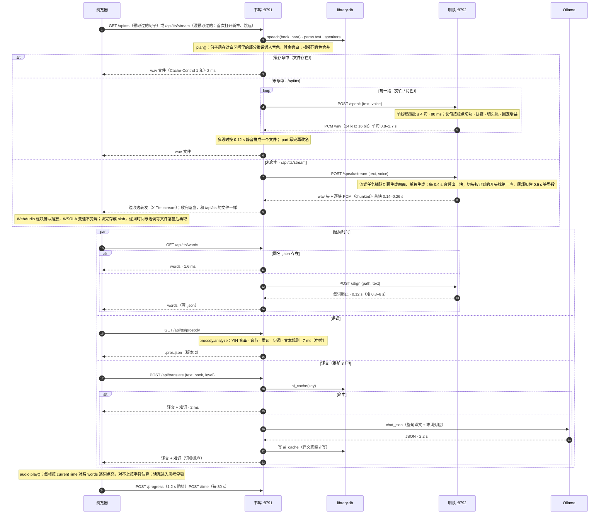
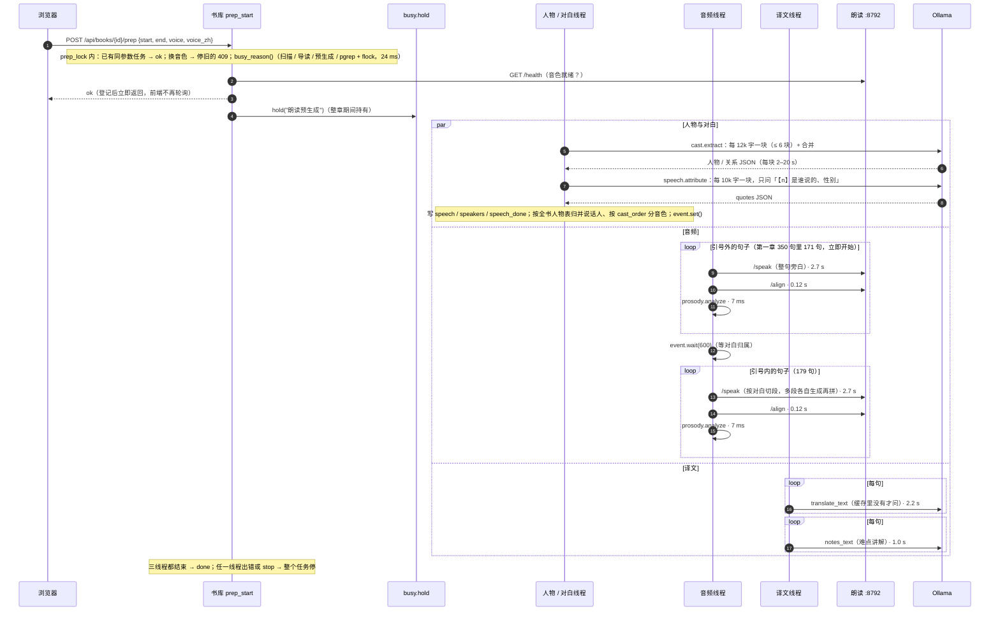
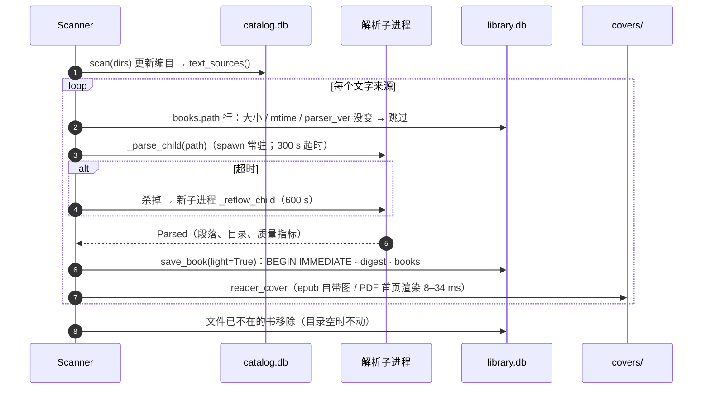
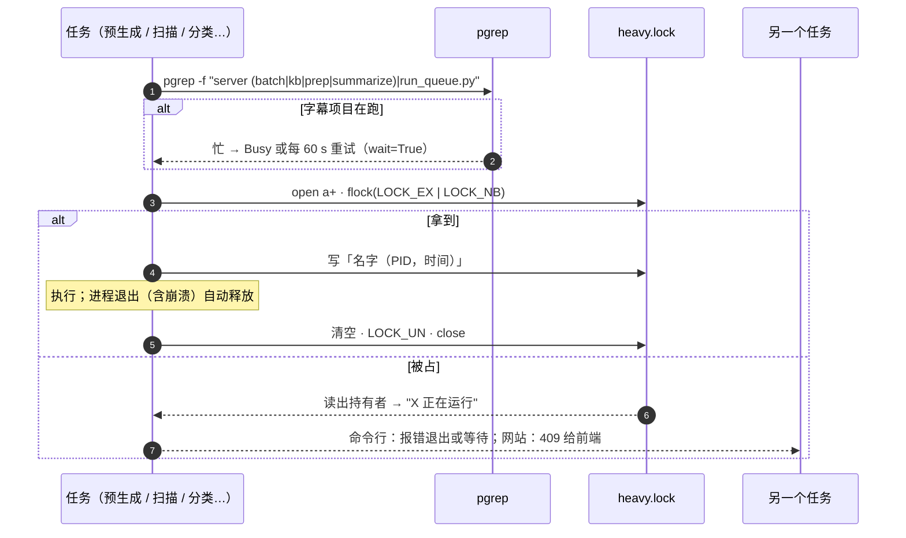

# 关键流程时序

> 图中的耗时为 2026-10-17 实测（见 [README · 基线与测法](README.md#基线与测法)）。参与者：浏览器 = `reader.js`，书库 = `:8791`（`narrate.py` 等），朗读 = `:8792`（`tts/server.py`），模型 = Ollama。

## 1. 阅读页播放一句

一句话从「进入这一句」到「逐词点亮」要走四条并行请求；音频未命中时才会碰朗读服务。

| 环节 | 位置 | 实测 | 说明 |
|---|---|---|---|
| 朗读计划 | `narrate.plan / resolve` | 3 条主键查询，合计 < 0.1 ms | `speech` 表为空时整句旁白 |
| 生成 | `tts/server.py Voice.speak` | 单句平均 2.70 s（日志 1,402 句）；一次冷请求 2.20 s 出 5.5 s 音频 | 实时率约 0.4–0.5；批 ×3 每句 1.93 s，批 ×4 反而 2.91 s |
| 流式 | `Voice.stream` → `narrate.stream_plan` | 模型首块 0.14–0.26 s；阅读页点击未缓存句到出声 0.58 s（队列空闲） | 预生成跑着时要等正在生成的那一批做完（2 s 起）；见 review §4 |
| 对齐 | `Voice.align`（独立线程） | 平均 0.12 s（最近 200 句）；空闲后首句 0.83 s，日志最大 6.1 s | 单独线程，不和生成争 MLX |
| 语调 | `prosody.analyze` | 中位 7 ms、均值 11 ms、最大 34 ms（30 句） | 纯 numpy |
| 译文 | `translate_text` | 冷 2.17 s，热 2 ms；难点讲解冷 1.04 s | `num_ctx` 6144 |
| 进度 | `POST /api/books/{id}/progress` {para, sent, rev, tab, force} | 条件 UPDATE，一条语句；每次记 `progress_log`（被拒的 ok=0，保留 60 天） | rev = 页面上次对上的 `last_read`，tab = 页面编号；服务端那条是同一页面写的（隐藏时 sendBeacon，rev 没跟上）照样能写；之后别处（mini、另一个标签页）写过就 409 带回服务端进度，旧标签页隐藏 / 重载时存不回旧位置；正在朗读的页面 force 以自己为准；页面回到前台（visibilitychange / focus / pageshow）`GET` 一次，别处读到别的地方就从那一句重新打开 |
| 前端预取 | `speak()` / `warmAudio()` | 当前句音频到手（流式：响应头到手）后先取下一句，再取后 5 句（音频 + 逐词时间）；`begin()` 时取后 3 句译文；打开、跳句、换音色后取当前句和后两句 | 预取走 `/api/tts`，在朗读服务里攒批 |

## 2. 按章预生成

| 要点 | 代码 | 影响 |
|---|---|---|
| 音频线程不等对白归属 | `narrate._prep_run.audio_worker`：先做引号外的句子（`speech.quoted_sents` 按段落引号区间判断，含没有引号字符的跨句对白中间句），再 `job["speech"].wait(600)` 做引号内的 | 盖茨比第一章 350 句：171 句立即开始；179 句等人物抽取（3 块 + 合并）与对白归属（4 次）共 8 次模型调用，与译文线程共用 Ollama；归属超时（300 s）只拖后半段。2026-10-17 改，之前音频线程第一行就等归属、晚 2–5 分钟起步 |
| 音频并发（2026-10-17 起） | 3 条线程，12 句一组按句长排序后同时送朗读服务（攒成一批），对齐、语调各自接着做 | 评审时串行每句 ≈ 2.85 s、一章 447 句 ≈ 21 分钟；并发后按批 ×3 实测估 ≈ 14 分钟（待整章复测） |
| 译文并发（2026-10-17 起） | 2 条线程（Ollama `NUM_PARALLEL=2`），先译文后讲解 | 评审时串行：22 分钟 724 次调用 |
| 锁持有时间 | 整章，gpu 类锁 | 只和导读、人物抽取、分类、向量等模型任务互斥；扫描、入库、去重在 io 类锁下照跑 |
| 句子去重 | `prep_sentences` 按句子文本去重 | 缓存键与播放完全一致 |
| 一个角色一种声音（2026-10-17 起） | `speech.assign_all`：说话人按全书人物表（`cast.people_all`，各章累计）归到同一个人，几种叫法（Nick / Nick Carraway、Daisy / Daisy Buchanan）共用最早分到的那个音色；戏份重的（提及次数 + 3 × 对白条数）先挑，按 `tts/voices.json` 的 `cast_order`（好听、知名度高的在前）取这本书还没人用的第一个，用完了复用用得最少的；叙述者（`cast.narrator`：模型给的 narrator 字段，或身份写着「叙述者」的人）自己的对白用旁白音色 | 之前按说话人字符串各自分、从哈希位置起挑：盖茨比里 Nick 和 Nick Carraway 两种声音、Gatsby 配到 Joe Rogan。`python -m library recast 书id` 清掉重分；朗读缓存键含音色，换了自动重生成 |
| 全书角色准备（2026-10-17 起） | `roles.sweep`：人物 → 归属 → 音色按章推进，正在读的章先、再往后、最后往前；三处触发：预生成做完当前章接着扫（同一把锁）、打开阅读页 20 s 后还有章没准备就后台起（同一本书 10 分钟内一次）、`python -m library voices 书id`（`--all` 给读过的书都补）。用户要起预生成、导读时 `busy_reason()` 叫停它（当前这次模型调用做完就停），预生成登记后等它放锁再开始 | 之前只有按播放的那一章会做人物和归属，读到下一章就退化成旁白 |
| 归属失败不记做完 | `speech.attribute` 返回每一块是否成功；超时、不是 JSON、一条都没认出都算失败，范围不记 `speech_done`，下次只补缺的段；`roles.status` / `speech.ensure` 发现「有引号段、一段归属都没有、却记了做完」的旧记录就删掉重做 | 盖茨比第五、六章：4 块归属全部超时（120 s，和译文线程抢模型）却记了做完，整章旁白、永不重试 |
| 人物和归属先于译文 | `_prep_run.tr_worker` 先等 `job["speech"]`（上限 900 s）再开始译文；人物、归属超时 120 → 300 s | 模型空闲时一块归属 10k 字 36 s、77/77 条认出；和两条译文线程抢时超过 120 s |
| 开着不关的页面跟上服务端（2026-10-17 起） | `/read` 页面和 `/text` 响应都带 `reader/main.js` 的内容哈希 `ver`；页面取正文时发现不一致就标 stale，读完当前句（或没在读时马上）`location.replace` 到 `?para=&sent=&play=1` 重新打开，在读的接着读；`speechSync` 对「有引号却没有归属」的段落每分钟补刷一次，不管早先是否标过做完 | mini 上的 Chrome 标签页几天不关：之前一直跑旧脚本、缓存着归属为空的段落，只有旁白一种声音 |
| 关系图点亮说话人 | 前端 `castMark`：对白句点亮归属的说话人，旁白句点亮叙述者（虚线圈），句里提到的人半亮并显出与说话人的关系；`/text` 多返回 `narrator`，`speech` 每条多一位「是否叙述者」 | 之前点亮的是句子里提到的人，不是在说话的人 |

## 3. 新书入库流水线

| 步 | 命令（`tools/ops/new-books.sh`） | 做什么 | 锁 | 产物 |
|---|---|---|---|---|
| 等空闲 | `busy.other_jobs()` 每 2 分钟 | 字幕项目队列或本项目长任务在跑就等 | — | — |
| ⓪ 收件箱 | `library.ingest --apply` | 非书文件留下；指纹相同且逐字节相同的进废纸篓（指纹相同字节不同的留在收件箱人工看）；去广告改名、移进书库 | `hold("新书入库")` | `logs/ingest-时间.txt` |
| ② 入库 | `python -m library scan`（`caffeinate`，`--workers=N`） | 先编目再按作品文字来源解析，4 个子进程并行，同一文件只解析一次；只存书目 + 摘要（摘要进 digest.db）；不再预画封面 | `hold("书库扫描", kind="io")` | `logs/scan-时间.log`；2026-10-17 实测 19,859 个新文件 53 分钟 |
| ②′ 拦截 | `library.exclude sweep --apply` | 编目时命中排除名单的新文件移到废纸篓 | `hold("排除书库")` | `exclude.runs` |
| ③ 体检 | `tools/quality_gate.py --since --apply` | 这次的新书：坏文件（碎片化、乱码、残缺、读不出正文、文件损坏）直接删、指纹记进排除名单；能修的（重转、修复、重新入库）修好；扫描版标翻阅 | 读 digest | `logs/quality-gate-时间.csv`、`logs/unreadable-时间.txt` |
| ③′ 门禁 | `library.exclude gate --since --apply` | 「扫描版」「质量」两条门禁（不看 config，总是开着）命中的直接排除，不用复核；规则见 data-model.md「质量」排除规则 | `hold("排除书库")` | `logs/exclude-gate-*.tsv`、`logs/exclude-时间.txt` |
| ④ 去重 | `library.dedupe --apply` | 同一作品多份只留一份：每个版本打开量正文字数，读不出、「�」超两成的不留，比最长的少 13% 以上的排后面，再按格式（epub > 有文字层的 pdf > mobi > txt）；正在读的那份仍优先。排在体检、门禁之后，体检判过的坏文件不会被留下 | `hold("去重")` | `logs/dedupe-时间.txt`、`fid_alias` |
| ④′ 重扫 | `library scan`、`quality_gate --since 去重时刻`、`exclude gate --since 去重时刻` | 留下的版本换了的书重新入库、体检、门禁 | 同 ②③ | 同 ②③ |
| ⑤ 难度 | `library.enrich level` | 词频覆盖率 → 难度分级（4 进程） | — | `enrich.level` |
| ⑥ 排除候选 | `library.exclude plan` | 按 `config.json` 里个人偏好的规则（类别、目录、刊名、教材）出候选报告，人工复核后再执行 | — | `logs/exclude-plan-*.tsv` |
| 后台 | `tools/ops/metadata.sh` | 元数据补全：书目层（ISBN、CIP、自带封面）→ 评分（Goodreads 数据集、Hardcover、Open Library）→ 简介 / 主题词 / 首版年（Open Library 按 ISBN）→ 外部封面（Open Library 按 ISBN，再按书名 + 作者）→ 按书名补（`enrich online`）→ 综合口碑分；Wikidata 并行；豆瓣评分、Apple Books 简介等出版日期任务结束再查。查过的不重查；已经在跑就不起第二份 | 书目层拿 io 锁，其余只联网 | `logs/metadata-日期.log`、各来源日志 |
| 之后 | `tools/ops/store-refresh.sh` | 推荐信号重建：两级分类（规则 → 模型兜底）→ 原著语言 → 原版 ↔ 译本 → 相似书 → 外文书中文书名（中文译本、Wikidata，都没有的本机模型译书名和作者，标注来源）、主题词译文 → 口味 → 搜索索引 → 综合口碑分；元数据补全跑完再跑一遍。网站预热线程自己重建物化视图、货架和「为你」 | 模型部分拿 gpu 锁 | `logs/store-refresh-日期.log` |

入库门禁是宁缺毋滥：原文件有问题（扫描件、加密、排版差、认不出字、不是正式出版的书、章节碎片）的书不进书库，宁可少一本，不要读的时候满篇错误。门禁只记被删那份文件的指纹，同一本书以后来了好的版本照常进来。直接用 `python -m library scan` 加书时，扫完跑一次 `python -m library.exclude gate --since <开始时间> --apply`；存量书隔段时间全查一遍：`tools/quality_gate.py --apply` 再 `python -m library.exclude gate --apply`。

扫描内部（单本）：

## 4. 长任务互斥

2026-10-17 起锁分两类：**gpu**（用本机模型：预生成、导读、人物抽取、分类、向量、中文翻译、译本关联，`heavy.lock`，并让开字幕项目的进程）和 **io**（只读写文件和库：扫描、入库、去重、排除、封面检查、补摘要、同一本书判定，`io.lock`）。每类同时只跑一件，两类互不阻塞：扫描时阅读页照样预生成。下图是一类锁内的流程。

| 调用方 | 锁名 | 拿不到时 | 持有时长 |
|---|---|---|---|
| `python -m library scan / add` | 书库扫描（io） | 报错退出（`--force` 跳过） | 全库扫描：小时级 |
| 网站预生成 | 朗读预生成（gpu） | 409，前端一分钟后再试 | 一章：10–30 分钟 |
| 网站导读 / 人物抽取 | 章节导读 / 人物抽取 | 409 | 分钟级 |
| `classify`、`similar embed`、`match`（比对正文）、`zh`、`translations`（`--wait`） | 本地模型分类 / 相似书向量 / … | 每 60 s 重试 | 小时级 |
| `ingest`、`dedupe`、`exclude`、`covers audit` | 新书入库 / 去重 / 排除书库 / 封面检查 | 报错退出 | 分钟级 |
| `tools/slim_library.py` | 补摘要 | 等待 | 小时级 |
| `new-books.sh` | （只查询） | 每 2 分钟轮询 | — |

网站侧 `App.busy_reason(kind)` 还会把进程内的状态加进来：gpu 看导读 / 预生成，io 看扫描。
