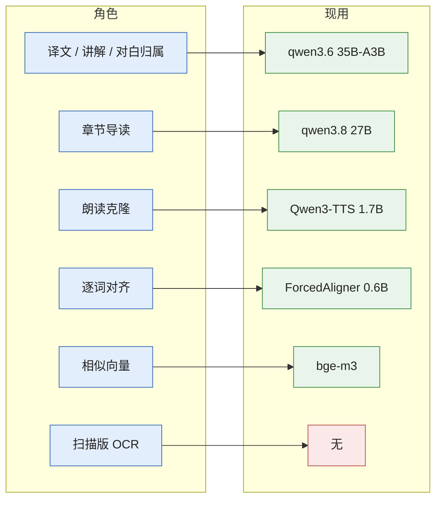
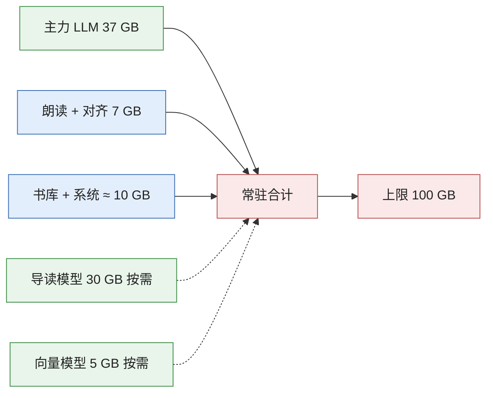

# 本机算力与本地模型：能力、升级与运行约束

> 口径：**本机可部署**的模型都在范围内，不限于开源（开放权重但带研究 / 非商用许可的、系统自带的，都算）。每一项都标了来源：**实测** = 2026-10-17 本机测得；**厂商** = 发布方自己的数字；**社区** = 第三方评测或博客，只作参考。
>
> 硬约束：方案必须在本机高性能运行。常驻内存不超过 100 GB、朗读首句出声不劣于现状、预生成吞吐不劣于现状，这三条是任何模型 / 运行时变更的验收线（见 §6）。

## 1. 本机算力（实测）

| 项 | 数值 | 来源 |
|---|---|---|
| SoC | Apple M5 Max，18 核 CPU（6 性能 + 12 能效，按 `hw.perflevel`），40 核 GPU，每核一个神经加速器，Metal 4 | `sysctl`、`system_profiler` |
| 统一内存 | 128 GB LPDDR5X；理论带宽 614 GB/s（40 核 GPU 版） | 实测容量；带宽为 [Wikipedia · Apple M5](https://en.wikipedia.org/wiki/Apple_M5) 列出的厂商数 |
| 系统 | macOS 26.6.2 | `sw_vers` |
| 磁盘 | 7.3 TB，余 4.0 TB；Ollama 模型目录约 223 GB（11 个模型） | `df`、`ollama list` |
| 运行时 | Ollama 0.35.1（最新 0.40.5）；mlx 0.32.3（最新 0.32.4）；mlx-audio 0.5.7（最新 0.5.9，10-13 发布）；mlx-qwen3-asr 0.4.4；Python 3.12 | `pip list`、PyPI、GitHub releases |

当前常驻占用（实测，`footprint` / `ps`）：

| 进程 | 常驻 | 其中 GPU 内存 |
|---|---|---|
| Ollama `qwen3.6:35b-a3b-q8_0` | 37.1 GB | 全部 |
| Ollama `translategemma:27b`（另一项目拉起，10 分钟后自动卸载） | 18.2 GB | 全部 |
| 朗读服务（Qwen3-TTS 1.7B bf16 + ForcedAligner 0.6B） | 6.8 GB | 6.5 GB |
| 书库服务 | 0.43 GB | — |
| 合计 | ≈ 62 GB / 128 GB | 两个 LLM 同时常驻时 ≈ 62 GB；再加章节导读模型（30 GB）就到 92 GB |

## 2. 本地模型实测吞吐

| 模型 / 任务 | 运行时 | 指标 | 实测 |
|---|---|---|---|
| `qwen3.6:35b-a3b-q8_0`（GGUF，llama.cpp 后端） | Ollama 0.35.1 | 解码 | 89.6–99.8 tok/s |
| 同上 | 同上 | 预填充（1,302 token 原文） | 2,946 tok/s；61 token 短提示 531 tok/s（固定开销占比大） |
| 同上，整句译文 + 难词（`/api/translate`） | 书库 → Ollama | 一句 | 冷 2.17 s（输出约 100–150 token） |
| 同上，难点讲解（`/api/notes`） | 同上 | 一句 | 冷 1.04 s |
| 同上，预生成批量 | 同上 | 平均每次调用 | 1.8–2.5 s（22 分钟 724 次；32 分钟 770 次） |
| Qwen3-TTS 1.7B Base bf16 | MLX（mlx-audio） | 单句生成 | 平均 2.70 s（1,402 句）；5.5 s 音频 2.2 s 生成，实时率 ≈ 0.4 |
| 同上 | 同上 | 攒批 | ×2 每句 2.93 s、×3 1.93 s、×4 2.91 s（批内句长不齐时补零抵消了收益） |
| Qwen3-ForcedAligner 0.6B | MLX（mlx-qwen3-asr） | 一句对齐 | 平均 0.12 s；空闲后首次 0.8 s，日志最大 6.1 s |
| 语调分析（numpy YIN） | CPU | 一句 | 中位 7 ms |
| bge-m3 | Ollama | 向量 | 未测（全量 37,707 本历史耗时「数小时」） |
| `qwen3.8:27b-q8_0`（原章节导读） | Ollama 0.35.1 / 0.40.6 | 解码（1,490 token 原文写导读） | 17.8 / 17.9 tok/s；500 token 输出 28 s |
| `qwen3.8:27b-mtp-q8_0`（现章节导读） | Ollama 0.35.1 / 0.40.6 | 同上 | 26.2 / 30.5 tok/s；500 token 输出 16.8 s；temperature 0 下输出与 `27b-q8_0` 逐字相同 |
| `qwen3.6:35b-a3b-q8_0` | Ollama 0.35.1 → 0.40.6 | 解码（178 / 1,490 token 输入） | 86.5 / 83.0 → 88.5 / 87.1 tok/s |
| 同上，2026-10-20 重新拉取的新权重（视觉投影拆成单独一层） | Ollama 0.40.6 | 同上 | 89.6 / 88.0 tok/s；冷载入 5.1 s → 2.0 s；译文只有个别措辞不同 |

对照厂商数字：Ollama 官方在 M5 Max 上用 Qwen3.5-35B-A3B 给出 llama.cpp 后端 58 tok/s → MLX 后端 112 tok/s、预填充 1,154 → 1,810 tok/s（[Ollama 0.40 发布说明与社区转述](https://www.developersdigest.tech/blog/ollama-0-40-mlx-default-disk-doubling-2026)）。本机现状 90–100 tok/s 已高于其 llama.cpp 数字（量化与上下文不同），升级后能否再提一截，要以本机复测为准。

## 3. 模型角色与候选（本机可部署）

### 3.1 译文 / 讲解 / 对白归属 / 人物抽取（主力 LLM）

| 候选 | 规模 · 许可 | 本机占用（估） | 速度（估） | 适配性 | 来源 |
|---|---|---|---|---|---|
| **Qwen3.6-35B-A3B**（现用，Q8） | MoE 35B / 3B 激活，Apache 2.0 | 37 GB | 实测 90–100 tok/s | 快，JSON 稳定；中英文学翻译质量中上 | 实测 |
| **Qwen3.8-27B**（已装 Q8，仅用于导读） | 稠密 27B，Apache 2.0，2026-08 发布 | 30 GB（Q8）/ 16 GB（4 bit） | 稠密 27B 预计 20–35 tok/s，比 MoE 慢 3 倍 | 推理与指令遵循显著强于 3.6（Artificial Analysis 指数 33.7 vs 21.4，社区转述）；翻译基准未见 | [kingy.ai](https://kingy.ai/blog/qwen3-8-27b-specs-benchmarks-local-hardware/)、[dev.to 对比](https://dev.to/jamilxt/qwen-38-27b-vs-qwen-36-27b-same-architecture-4-months-apart-and-a-different-kind-of-upgrade-3280) |
| **Gemma 4 31B**（已装） | 稠密 31B，Gemma 许可（可本机用） | 20 GB（4 bit） | 稠密，慢于 MoE | 通用知识强，MMLU-Pro 与 Qwen3.6 持平（社区） | [codersera](https://codersera.com/blog/gemma-4-vs-qwen-3-5-comparison-2026/)、[llmcheck](https://llmcheck.net/blog/gemma-4-vs-qwen-35-apple-silicon/) |
| Gemma 4 26B-A4B | MoE 26B / 3.8B 激活 | 比 Qwen 35B MoE 少约 6 GB | 与 Qwen3.6 同档 | 128K 上下文；可作第二快模型 | 同上 |
| **translategemma 27B**（已在机上） | Google 翻译专用，Gemma 许可 | 18 GB（Q4） | 稠密 27B | 只做整句译文时可能更忠实；不适合 JSON 多任务 | 本机 `ollama list` |
| Qwen3.5-122B-A10B | MoE 122B / 10B 激活 | 4 bit ≈ 70 GB | 10B 激活，估 40–60 tok/s | 质量上限更高，但与 TTS、导读模型不能同时常驻 | [popularai](https://www.popularai.org/p/best-local-llm-mac-mini-m4-2026) |
| Apple Foundation Models（系统 3B） | macOS 26 自带，免费离线 | 已在系统里 | 快 | 只能从 Swift / 系统 API 调用，中文文学翻译能力不足；不建议 | [Apple 框架介绍](https://createwithswift.com/exploring-the-foundation-models-framework/) |
| DeepSeek V3.x / GLM-5 / Kimi K2 / MiniMax M2.5 | 230B–1T | 4 bit 125–380 GB | — | **超出 128 GB，排除** | 规模推算 |

建议：主力保持 MoE（速度决定预生成吞吐）；**对白归属与人物抽取**是「少量调用、要准」的任务，换成 Qwen3.8-27B 做 A/B（每章 8 次调用，慢 3 倍也只多两三分钟，但归属错误会直接听出来）；整句译文做一次 50 句盲评（3.6 MoE vs 3.8 27B vs translategemma），再决定。

### 3.2 朗读与音色克隆（TTS）

| 候选 | 许可 | 本机运行 | 克隆 | 质量信号 | 来源 |
|---|---|---|---|---|---|
| **Qwen3-TTS 1.7B Base**（现用） | Apache 2.0；0.6B / 1.7B，10 种语言，支持流式（厂商称首包 97 ms） | MLX（mlx-audio），6.5 GB | 3 秒参考音频零样本 | 实测实时率 0.4；大教室混响等环境音会被保留 | [QwenLM/Qwen3-TTS](https://github.com/QwenLM/Qwen3-TTS) |
| Fish Audio S2 Pro | 研究许可（非商用） | PyTorch MPS；MLX 未见 | 零样本 | Controlled Voice Arena 开放权重第一（1,034 Elo，2026-07） | [Artificial Analysis](https://artificialanalysis.ai/text-to-speech/leaderboard/provider-voice/open-weights) |
| Mistral Voxtral TTS | CC BY-NC 4.0 | **mlx-audio 已支持** | 零样本 | 同榜 1,024 Elo，8 月快照第一 | 同上、[mlx-audio 报道](https://alphasignal.ai/news/mlx-audio-brings-646-language-voice-cloning-to-apple-silicon-without-the-cloud) |
| Resemble Chatterbox | MIT | PyTorch MPS | 零样本，23 种语言 | 同榜 930 Elo；社区称盲测胜 ElevenLabs（未证实） | 同上 |
| Microsoft VibeVoice 7B | MIT | PyTorch | 长篇多说话人 | 916 Elo | 同上 |
| CosyVoice 3 | Apache 2.0 | PyTorch MPS | 零样本，中文方言强 | 无同口径榜单数据 | [pinggy 综述](https://pinggy.io/blog/best_open_source_self_hosted_text_to_speech_models/) |
| Kokoro-82M | Apache 2.0 | MLX，极快 | 无克隆 | 适合中文旁白兜底 | 同上 |
| Apple 个人声音 / AVSpeech | 系统 | 系统 API | 只能克隆自己的声音 | 不适用 | — |

建议：**不换模型先换用法**——Qwen3-TTS 本身支持流式输出，`mlx-audio` 的 `generate` 已按块返回，当前服务端把块拼完才回包；改成分块回包可把首句出声从 2.2 s 压到 0.5 s 以内（实测需验证，见 review）。同时用同一套 8 个参考音色对 Voxtral TTS（已在 mlx-audio 里，零改造成本）做一次盲听对比；Fish S2 Pro 质量最高但是 PyTorch 路径，要另起环境并占 GPU，只在盲听明显胜出时考虑。

### 3.3 逐词对齐

| 候选 | 本机运行 | 精度 / 特点 | 评价 |
|---|---|---|---|
| **Qwen3-ForcedAligner 0.6B**（现用） | MLX，0.12 s/句 | 80 ms 网格，约 3% 词时长为 0（`prosody.py` 注释） | 已不是瓶颈 |
| MMS 强制对齐（torchaudio CTC） | PyTorch MPS | 1,100+ 语言，帧级 20 ms | 若要更细的音节级边界可试 |
| Montreal Forced Aligner | CPU | 音素级 | 语调分析若要音素边界而非 IPA 推算，这是标准方案；装 Kaldi 环境成本高 |
| Apple SpeechAnalyzer（macOS 26） | 系统 | 词级时间范围（需验证） | 只能走 Swift，不建议 |

建议：保持现状；只有当语调分析的音节切分误差成为用户可感知问题时再评估 MFA。

### 3.4 相似书向量

| 候选 | 规模 · 许可 | 向量维度 | 质量信号 | 代价 |
|---|---|---|---|---|
| **bge-m3**（现用） | 568M，MIT | 1024 | 多语言主流 | 已算完 37,707 本 |
| **Qwen3-Embedding-8B**（已装） | 8B，Apache 2.0 | 32–4096 可裁 | MTEB 多语言榜首（70.58），C-MTEB 73.84（厂商论文） | 全量重算：数小时；裁到 1024 维存储不变 |
| Qwen3-Embedding-4B | 4B | 同上 | 略低于 8B | 约一半时间 |

来源：[Qwen3 Embedding 论文](https://arxiv.org/abs/2506.05176v3)、[zilliz 汇总](https://zilliz.com/ai-faq/qwen3-embeddings-vs-alternatives-mteb-ranking)。建议：先在 1,500 本样本上重算并复用 `similar calib` 的门槛标定流程，跨语言「候选译本」命中率提升才值得全量。

### 3.5 能力增强：扫描版 PDF 读出正文（现在只能翻阅）

| 候选 | 本机运行 | 特点 |
|---|---|---|
| Apple Vision 文字识别 | 系统框架，CPU/ANE，免费 | 中英文印刷体快且准；需一个小的 Swift 命令行工具 |
| Qwen3.8 / Gemma 4 视觉版 | Ollama MLX 后端支持图像 | 版面理解强（Qwen3.8 自称 OmniDocBench 91.1），但每页一次推理，一本 300 页书要十几分钟 |
| PaddleOCR-VL、DeepSeek-OCR、dots.ocr | PyTorch | 文档专用，精度高；环境另起 |

这是「扫描版入库」的能力缺口，不在本次性能评审范围，列为路线图第三阶段。

### 3.6 其他

| 角色 | 现用 | 可替代 |
|---|---|---|
| 装音色时的参考转写 | Qwen3-ASR（`tools/add_voice.py`） | Whisper large-v3-turbo（MLX）、Parakeet TDT（MLX）、Apple SpeechTranscriber |
| 章节导读 | `qwen3.8:27b-mtp-q8_0`（MTP 推测解码，输出与 `27b-q8_0` 相同） | Gemma 4 31B；或改用主力 MoE 多轮 map-reduce 换速度 |

## 4. 运行时升级：Ollama 与 MLX

| 事实 | 来源 |
|---|---|
| Ollama 0.40.0（2026-09-25）起，Apple 芯片上 MLX 运行时支持的架构默认走 MLX；0.40.4 修了推测解码稳定性；0.40.5（10-14）更新 MLX | [GitHub releases](https://github.com/ollama/ollama/releases?page=1)（本机抓取发布说明） |
| 社区解读：GGUF 文件仍走 llama.cpp，MLX 路径要 safetensors / MLX 格式；0.40 第一次加载旧 GGUF 时会在后台转格式，期间占双倍磁盘 | [developersdigest](https://www.developersdigest.tech/blog/ollama-0-40-mlx-default-disk-doubling-2026) |
| 独立对比（M5 Pro，Llama 3.1 8B Q4）：mlx-lm 62 tok/s、Ollama 48、llama.cpp 52；70B Q4：14 / 10 / 11 | [promptquorum](https://www.promptquorum.com/local-llms/mlx-vs-ollama-vs-llama-cpp-mac) |
| arXiv 2511.05502（M2 Ultra）：MLX 持续吞吐最高；Ollama 重易用性、吞吐与首 token 延迟落后 | [arXiv](https://arxiv.org/abs/2511.05502v1) |
| `mlx_lm.server` / oMLX 提供提示前缀缓存与连续批处理（社区称高并发下最多 4 倍，未验证） | [toolradar](https://toolradar.com/compare/omlx-vs-ollama) |
| 本机 2026-10-20 实测：升到 0.40.6 后，Q8_0 的 GGUF 模型（`qwen3.6:35b-a3b-q8_0`、`qwen3.8:27b-q8_0`）仍由 `llama-server` 加载，没有走 MLX，解码只快 0–5%；要走 MLX 得换 `-mlx` / `mxfp8` / `nvfp4` 标签（模型名变，`ai_cache` 译文缓存随之失效） | 本机 `/tmp/ollama.err.log`、§2 测速 |

本项目的调用模式：**系统提示长、用户内容短、同一提示反复几百次**（译文、讲解、对白归属），正是前缀缓存受益最大的形态。升级路线：

1. ~~Ollama 0.35.1 → 0.40.5~~ 已升到 0.40.6（2026-10-20）；用 `ollama ps` 和日志确认主力模型是否已在 MLX 运行时；GGUF 没切过去就重新拉 MLX 格式的同名模型。
2. 用 §2 的同一组请求复测解码 / 预填充 / 一句译文耗时，记入 [README · 基线](README.md#基线与测法)。
3. 若 Ollama 的 MLX 路径仍不做前缀缓存，试 `mlx_lm.server`（OpenAI 兼容接口，`llm.py` 只需改 URL 和请求格式），对比一句译文的首 token 延迟。
4. mlx-audio 0.5.7 → 0.5.9、mlx 0.32.3 → 0.32.4（朗读服务），复测单句生成与批量生成。

## 5. 内存预算与并发（硬约束）

| 规则 | 理由 |
|---|---|
| 常驻 ≤ 2 个 LLM（`OLLAMA_MAX_LOADED_MODELS=2`），导读模型 `keep_alive` 缩到 5 分钟 | 37 + 30 + 18（别的项目）= 85 GB 已逼近上限；再加 TTS 与页缓存会触发交换 |
| 预生成时 TTS 生成与 LLM 解码同时跑 | 两者都受内存带宽限制而非算力，互相拖慢（批 ×4 异常可能源于此）；评审里建议音频并发 ≤ 3、译文并发 ≤ 2，并分别复测 |
| 不引入第二个 PyTorch/MPS 常驻服务 | 一个 MLX 进程 + Ollama 已占 GPU；Fish / Chatterbox 只做离线盲听，不常驻 |
| 任何模型切换先过验收线 | 见 §6 |

## 6. 验收线与评测集

| 指标 | 现状基线 | 验收 |
|---|---|---|
| 朗读首句出声（未命中缓存） | 2.2 s | 不劣于现状；流式方案目标 ≤ 0.6 s |
| 预生成吞吐（一章 447 句） | 音频 ≈ 21 分钟、译文 ≈ 22 分钟 | 不劣于现状 |
| 整句译文质量 | 50 句盲评集（盖茨比第 1 章抽样 + 10 句长难句） | 新模型胜率 ≥ 60% 才换 |
| 对白归属准确率 | 第 1 章 179 句对白人工标注 | ≥ 现用模型 |
| 音色相似度与自然度 | 8 个参考音色 × 5 句盲听 | 不劣于 Qwen3-TTS |
| 常驻内存 | 62 GB | ≤ 100 GB |
| GPU 超时 / 崩溃 | 0 | 0 |

## 7. 路线图

| 阶段 | 内容 | 预期 | 工作量 |
|---|---|---|---|
| 0 基线 | 把 §2 的测法写成 `tools/bench.py`（解码 / 预填充 / 一句译文 / TTS 单句与批 / 对齐 / 向量），结果追加到文档 | 以后每次升级有同口径对照 | 0.5 天 |
| 1 运行时 | Ollama 0.40.x + MLX 模型格式；mlx / mlx-audio 升级；前缀缓存试验 | 译文每句 2.2 s → 目标 1.2–1.5 s；解码 +20–50%（待实测） | 0.5 天 + 复测 |
| 2 用法 | TTS 流式回包；预生成并发与批内按句长排序；对白归属改 27B 做 A/B | 首句 ≤ 0.6 s；预生成 ≈ −30% | 1–2 天 |
| 3 模型 | 译文 / 导读 / 向量三项 A/B（Qwen3.8-27B、translategemma、Qwen3-Embedding-8B）；Voxtral TTS 盲听 | 质量提升，速度不退 | 2–3 天（含评测集） |
| 4 能力 | 扫描版 OCR 入库（Apple Vision 优先） | 扫描版可朗读 | 2–3 天 |
