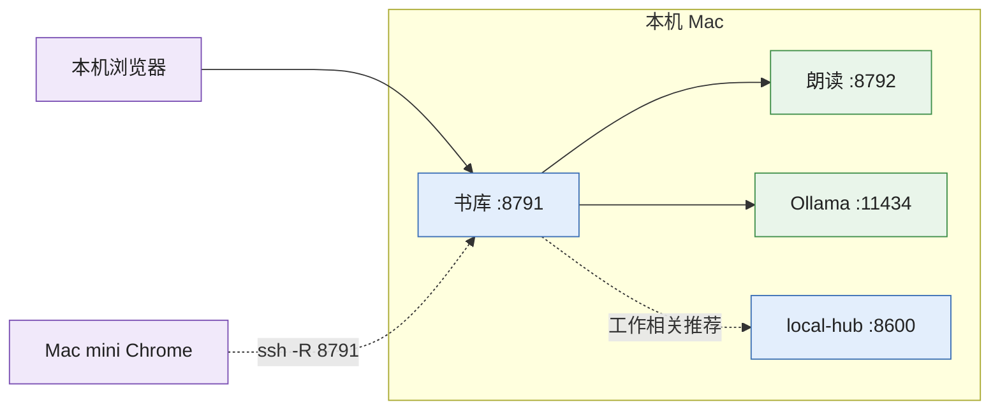
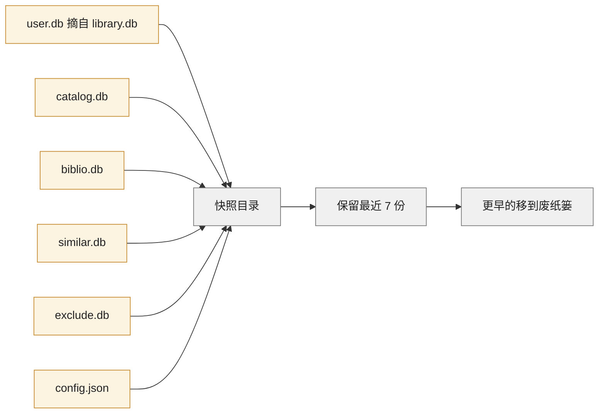

# 部署与运维

> 现状核对日期 2026-10-17。标注「现状」的条目是本机当时的真实状态，不是脚本的设计意图。

## 1. 进程与端口

| 进程 | 启动命令 | 环境 | 监听 | 常驻内存（实测） | 守护 |
|---|---|---|---|---|---|
| 书库 | `.venv/bin/python -m library serve`（`start.sh` 顺带拉起朗读） | `.venv` | `127.0.0.1:8791`（只服务本机 Host，写请求校验同源） | 0.43 GB | launchd `com.lectern.server`（2026-10-17 装上；崩溃 10 s 后拉起，登录自动启动） |
| 朗读 | `.venv-tts/bin/python tts/server.py` | `.venv-tts`（mlx 0.32.3、mlx-audio 0.5.7、mlx-qwen3-asr 0.4.4） | `127.0.0.1:8792` | 6.8 GB（GPU 内存 6.5 GB） | launchd `com.lectern.tts`（2026-10-17 装上） |
| Ollama | `ollama serve` | Homebrew 0.35.1 | `127.0.0.1:11434` | 模型常驻：qwen3.6 35B-A3B 37 GB（+ 另一项目的 translategemma 18 GB） | launchd `com.readmigo.ollama`（`NUM_PARALLEL=2`、`KEEP_ALIVE=10m`、`CONTEXT_LENGTH=8192`、`FLASH_ATTENTION=1`） |
| 解析子进程 | 由书库 / 扫描进程按需 spawn | `.venv` | — | 随书大小 | 父进程退出自动退出 |

## 2. 启动入口

| 入口 | 做什么 | 备注 |
|---|---|---|
| `start.sh` | 没有 `.venv` 先建；朗读服务没在跑就用 `run-service.sh` 后台拉起；前台 `exec` 书库 | 书库前台、朗读后台 |
| `tools/ops/run-service.sh <名字> <命令…>` | 输出追加到 `logs/<名字>.log`，启动前超过 20 MB 就轮转（保留 .1 .2 .3）；把 Homebrew 的 `bin` 补进 PATH——launchd 默认 PATH 只有系统目录，逐词对齐（mlx_qwen3_asr 用 ffmpeg 解码 wav）没有它就全部失败，阅读页只能按字符估算点亮 | launchd 和 `.command` 都经它 |
| `打开英文书库.command` | health 不通 → 有 launchd 就 `kickstart`，否则 `nohup` 起；等最多 60 s；打开浏览器 | 日常入口 |
| `重启英文书库.command` | launchd 存在则 `kickstart -k`，否则 `pkill` 后重起 | 改代码后用 |
| `扫描书库.command` | `caffeinate -i python -m library scan` | 可随时关窗口，下次接着扫 |
| `安装 默认音色.command` | `tools/setup_tts.sh`：建 `.venv-tts`、拉模型（约 4 GB）、生成试听 | 一次性 |
| `首次安装并导入盖茨比.command` | 建环境、导入示例书、跑测试、启动 | 一次性 |
| `tools/ops/install-service-agents.sh` | 写两个 LaunchAgent（`RunAtLoad`、`KeepAlive` 失败即拉起、`ThrottleInterval` 10 s）并 bootstrap | `--remove` 卸载 |
| `tools/ops/install-backup-agent.sh` | 每天 03:30 跑 `tools/backup.py`（睡过了醒来补跑） | `--remove` 卸载 |
| `tools/ops/install-git-hooks.sh` | `pre-push` 跑测试 | 未安装；GitHub Actions 已在跑 pytest |
| `python -m library vacuum` | 整理 library.db、digest.db、catalog.db（删过大量行后把空闲页还给文件系统） | 要在写入方空闲时跑 |
| `python -m library.coverage --missing` | 书城每栏（英文书 / 中文书 / 译文）缺评分、封面、简介、作者、出版年、ISBN、分类的本数和比例（`--json` 给脚本用） | 只读，不到 1 秒 |
| `tools/ops/metadata.sh` | 元数据补全全流程（联网、慢，可断点续跑；new-books.sh 最后在后台起它） | 同时只跑一份（`data/.jobs/metadata.pid`） |
| `tools/ops/store-refresh.sh` | 书库大改后重建推荐信号（分类、原著语言、译本、相似书、口味、搜索） | 模型部分排队等 gpu 锁 |
| `python -m library covers-prune` | 删掉从没读过的书的封面（显示时现画） | 2026-10-17 起扫描不再预画封面 |
| `python -m library scan --workers=N` | 并行解析数（默认 4，文件少于 8 个时串行） | 大文件（> 50 MB）超时减半 |

## 3. 日志

| 文件 | 来源 | 内容 | 现状 |
|---|---|---|---|
| `logs/server.log` | 书库（`run-service.sh`） | uvicorn `warning` 级；httpx 每次调用 Ollama / 朗读服务一行 INFO；业务 `log.warning`（人物抽取失败等） | 765 KB；2,600 行 Ollama 调用记录，每 30 s 两条 `/health`（音色表两处各自刷新） |
| `logs/tts.log` | 朗读服务 | 每批生成一行（耗时 × 句数 [音色] 文本）、每句一行、每次对齐一行 | 433 KB；是本评审 TTS 耗时的数据来源 |
| `logs/backup.log` | 备份 agent | 快照清单、异地推送结果 | 每天 03:30 一次 |
| `logs/scan-时间.log`、`ingest-*.txt`、`dedupe-*.txt`、`quality-gate-*.csv`、`exclude-*.txt`、`enrich-online.log`、`classify-*.log`、`add_voice_*.log` | 各命令行任务 | 进度与清单 | 177 个文件，不轮转 |
| `/tmp/ollama.out.log`、`/tmp/ollama.err.log` | Ollama launchd | 模型加载、请求 | 系统临时目录 |

## 4. 备份与可再生性

| 数据 | 可再生？ | 重建代价 | 备份方式（`tools/backup.py`） | 现状 |
|---|---|---|---|---|
| `library.db` 的 `books` 进度列、`guides`、`ai_cache` | 否 / 否 / 可重算但要模型时间 | — | 摘到 `user.db`（SQLite 在线备份，不碰 `digest`、`paras`） | 最近快照 2026-10-13 00:53 |
| `library.db` 的 `cast`、`speech*`、`reading_log` | 否 | — | 摘到 `user.db`（2026-10-17 纳入） | 随每日快照 |
| `paras`（library.db）、`digest`（data/digest.db，608 MB） | 是 | 打开时 / 扫描时重算；全库摘要数小时 | 不备份 | 摘要 2026-10-17 起单独一个库，library.db 118 MB |
| `catalog.db`、`biblio.db`、`similar.db`、`exclude.db` | 部分 / 部分 / 是（数小时） / **否** | — | 整库在线备份 + `quick_check` | 随每日快照；`exclude.db` 不可再生，是备份里最要紧的一份 |
| `search.db` | 是（几十秒） | — | 不备份 | — |
| `data/tts`、`covers`、`store_covers`、`cache` | 是 | 朗读缓存一章约 20 分钟；封面全量约 15 分钟 | 不备份 | — |
| `data/voice`（参考音频、转写、出处） | 否（来源视频可能下架） | — | 进 git（`sample.wav`、`bed.m4a`、`_src` 除外） | 164 个音色目录 |
| `config.json`（含外部来源 key） | 否 | — | 复制，权限 600 | — |

恢复：停服务 → 整库文件拷回 `data/` → `tools/backup.py --restore-user 快照/user.db` 写回进度、导读、译文缓存。结构升级会删表时 `db.py` 自动先做 `library.db.bak-时间`（现有一份 2026-10-07，0.8 MB，可删）。

## 5. 版本与失效机制

| 版本号 | 位置 | 变了会怎样 |
|---|---|---|
| `PARSER_VER` = 2，`PARSER_VERS` = {txt: 3} | `extract.py` | 旧版本解析的书在扫描或打开时重新解析；`PARSER_VERS` 里的格式单独记版本，只重新解析这一种格式（txt 3 = 按原文件的行和空行分段） |
| `CATALOG_VER` = 7 | `catalog.py` | 编目时重读元数据 |
| `prosody.VERSION` = 2 | `prosody.py` | 旧 `.pros.json` 下次用到时重算 |
| 音色指纹 `vid` | `tts/server.py voice_id`（模型名 + 参考音频 + 参考文字） | 朗读缓存文件名含它，换音色自动另存 |
| 模型名 | `config.model / guide_model` | `ai_cache` 键含模型名，换模型等于清空译文缓存 |
| `user_version` | 各库 | 打开时在 `BEGIN IMMEDIATE` 里按 `STEPS` 追加迁移 |
| 静态文件 `?v=` | `reader.py`、`web.py`、`shelf.py` 里手写 | 改了脚本要同步改版本号（无构建步骤） |

## 6. Mac mini 访问

书库只监听 `127.0.0.1`，另一个房间的 Mac mini 靠反向 SSH 隧道访问。两台路由器内网都是 `192.168.0.x`，从本机扫局域网永远找不到 mini。

| 项 | 内容 |
|---|---|
| 唯一通路 | `ssh macmini`（`~/.ssh/config` → 192.168.1.69:2222 → 路由器虚拟服务器转发到 mini:22） |
| 投到 mini | 阅读页右上「投到 mini」（快捷键 M）：本机暂停并存好当前句 → `POST /api/mini/open` → mini 的 Chrome 打开同一本书、停在同一句；mini 上已有书库标签页就原地换书，没有才新开；顺带点亮 mini 屏幕。实测隧道新建 2.0 s、已通 0.7 s |
| 开关 | `data/config.json` 的 `mini_ssh`（`~/.ssh/config` 里的主机名，现为 `macmini`）；空着不显示按钮，改后重启书库 |
| 隧道 | 书库进程自己管（`library/mini.py`）：`serve` 一启动就起 `ssh -N -R 127.0.0.1:8791:127.0.0.1:8791 macmini`，此后每 10 s 看一次，断了就重连（书库重启后 mini 上的页面刷新即可续上）；mini 上 8791 已通（别处起的隧道）就不起第二条；mini 连不上（睡眠、断网）每 60 s 再试 |
| 报错 | 连不上时按钮提示改哪里：2222 拒绝 → mini 换了内网 IP 或远程登录关了；超时 → mini 睡眠 / 关机 / 停在登录界面 |
| launchd | `com.hongbin.macmini-tunnel` 只转发 8787（公开课），不管 8791 |
| 排查 | 1.69 不通 → mini 房间路由器断电或光猫换了它的 WAN IP；2222 拒绝 → mini 换了内网 IP 或远程登录关了；2222 超时 → mini 睡眠 / 停在登录界面；SSH 通但 health 不通 → 隧道或本机服务 |
| 带宽 | 书城首页 HTML 126 KB、`reader.js` 75 KB、每句音频约 240 KB，全部**未压缩**经隧道传输 |

## 7. 健康检查与日常操作

| 操作 | 命令 / 地址 |
|---|---|
| 书库健康 | `curl --noproxy '*' http://127.0.0.1:8791/api/health` → 书数、词典是否就绪 |
| 朗读服务 | `curl --noproxy '*' http://127.0.0.1:8792/health` → 模型是否加载、音色列表与指纹 |
| Ollama | `curl http://127.0.0.1:11434/api/ps` → 常驻模型与显存 |
| 谁在占长任务锁 | `.venv/bin/python -m library.busy` |
| 备份 | launchd 每天 03:30 跑 `tools/backup.py`：本地快照到 `~/Backups/english-library`，再 rsync 推到 Tokyo 服务器 `jp-proxy:/root/backups/english-library`（远端相同文件做硬链接，只传变化的十几 MB）；两边各留最近 7 份。手动跑：`launchctl kickstart gui/501/com.lectern.backup` |
| 结构升级后 | 看 `logs/server.log` 的「数据库升级前已备份到」 |
| 磁盘 | `data/`：`covers` 1.47 GB（可 `covers-prune`）、`digest.db` 0.61 GB、`library.db` 0.12 GB、`tts` 0.5 GB、`cache/store_wv.db` 40 MB（书城物化视图，可删会重建）；系统盘 7.3 TB |
