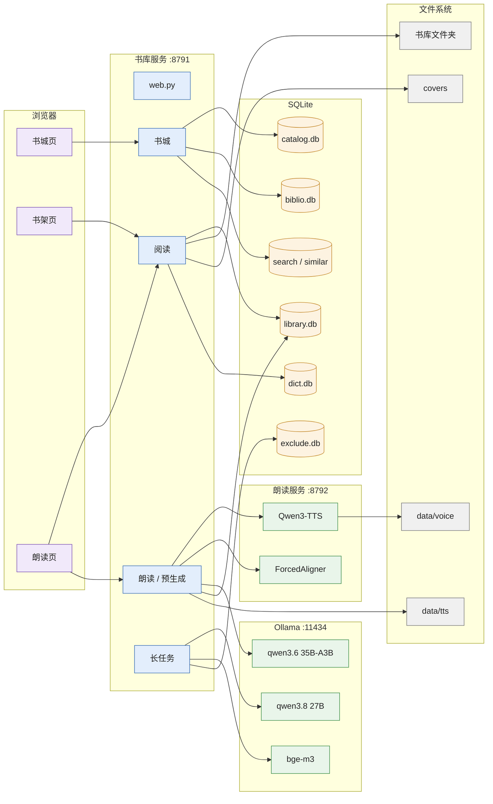
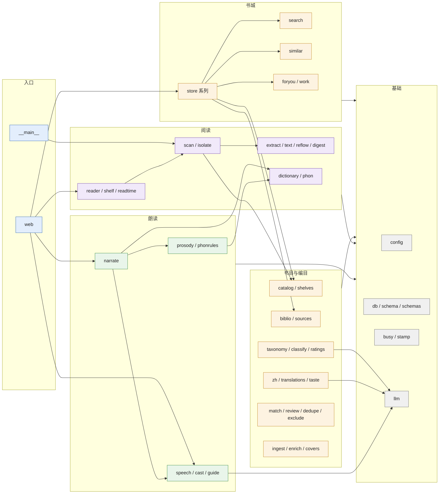
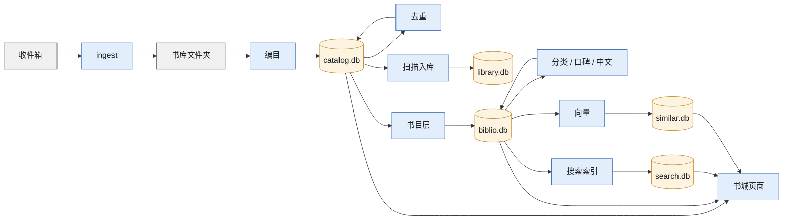
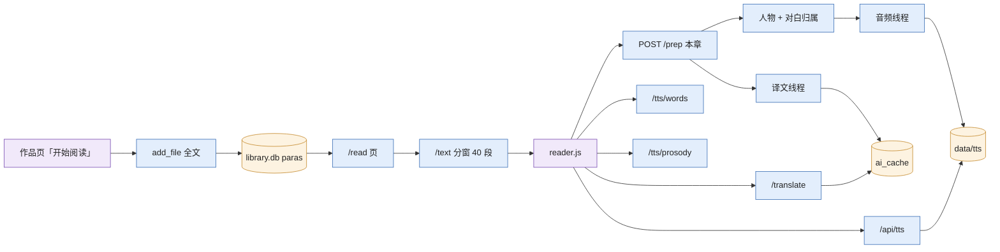

# 总体架构

> 基线：2026-10-17，MacBook Pro M5 Max（18 核 CPU / 40 核 GPU / 128 GB），macOS 26.6.2。各项数字均为本机实测或按实际文件统计，测法见 [README](README.md#基线与测法)。

## 1. 系统全景

全部组件跑在同一台 Mac 上，三个常驻进程 + 一个外部服务（Ollama），浏览器只和书库服务通信。

| 节点 | 职责 | 代码 / 位置 | 进程与环境 |
|---|---|---|---|
| 书城页 / 书架页 | 服务端渲染的 HTML，少量内联脚本（搜索联想、加入书库） | `library/store*.py`、`shelf.py`、`static/store.css`、`suggest.js` | 浏览器 |
| 朗读页 | 前端 ES 模块：分窗取段落、逐句取音频（预取过走文件，没预取过走流式）/ 逐词时间 / 语调 / 译文、逐词点亮、思考停顿、人物图、多角色状态 | `static/reader/main.js`（逻辑）、`util.js`（选择器、转义、设置、分词）、`stretch.js`（WSOLA 变速、wav 头）、`reader.css` | 浏览器 |
| web.py | FastAPI 应用、页面框架、只服务本机的中间件、`App` 共用状态（DB、词典、Ollama 客户端、扫描器、任务登记） | `library/web.py` | `.venv`，uvicorn 单进程 |
| 书城 | 只读 catalog.db + biblio.db（ATTACH）+ search.db + similar.db；视图 `wv`（作品、补全、书目层 7 张表）物化到 `data/cache/store_wv.db`，库变了后台重建、按连接换上 | `store.py`（`MatView`）及 `store_home / store_list / store_detail / store_media / foryou.py` | 同上 |
| 阅读 | 书页、阅读页、取正文（按段分窗）、进度、阅读时长、封面 | `reader.py`、`shelf.py`、`readtime.py` | 同上 |
| 资料 | `research/` 下的 Markdown 研究资料：渲染（表格、SVG、mermaid）、目录与全部文档；「送进阅读器」经扫描器入库一篇（`.md` 按 `md.py` 分段） | `research.py`、`md.py`、`static/research.css`、`static/vendor/mermaid.min.js` | 同上 |
| 朗读 / 预生成 | 译文与难词（Ollama + 词典）、朗读计划（按对白切段）、缓存文件、逐词对齐、语调分析、按章预生成三线程 | `narrate.py`、`speech.py`、`cast.py`、`prosody.py`、`phonrules.py` | 同上，后台线程 |
| 读法 / 导图 | 每本书的读法：外文 en（译文、生词）、文言 wy（文言句译成白话、注字词）、白话 zh（母语，不译不注，语速默认高一档）；右栏导图画人物关系还是这一节的概念导图。中文书按逐句文言判定的比例、比例居中时问模型定一次，存 `book_kind`；概念导图按二级目录小节抽，存 `maps` | `bookkind.py`、`concepts.py`（`/api/books/{id}/map`） | 同上，后台线程 |
| 视频图层 | 给讲堂视频（`~/dev/lecture-hall`）叠在 16:9 成片上的朗读页：透明底 1920×1080，逐词高亮、英英页边注释、英文人物网；页面按外部给的时间 `OV.seek(t)` 画帧，由讲堂流水线的 `pipeline/overlay.py` 用无头 Chrome 逐帧截图。注释和人物说明由 Ollama 生成，进 `ai_cache`（`ov1:` 前缀） | `overlay.py`（`/overlay`、`/api/overlay/data`）、`static/overlay/` | 同上；页面在无头 Chrome 里 |
| 长任务 | 扫描、导读、人物抽取、预生成在进程内；编目 / 去重 / 分类 / 向量 / 中文信息等在命令行进程；全部经 `busy.hold` 互斥 | `scan.py`、`guide.py`、`busy.py`、`library/*.py` 的 `main` | 进程内线程或独立命令行进程 |
| 朗读服务 | Qwen3-TTS 1.7B Base（bf16，MLX）零样本克隆，一个生成线程攒批（≤ 4 句，80 ms 窗口）；Qwen3-ForcedAligner 0.6B 单独线程做逐词对齐 | `tts/server.py` | `.venv-tts`，常驻 6.8 GB（GPU 内存） |
| Ollama | 译文 / 讲解 / 对白归属 / 人物抽取用 `qwen3.6:35b-a3b-q8_0`；章节导读用 `qwen3.8:27b-mtp-q8_0`；相似书向量用 `bge-m3` | `library/llm.py`、`config.py` | launchd `com.readmigo.ollama`，`OLLAMA_NUM_PARALLEL=2` |
| SQLite | 七个库各司其职，详见 [数据模型](data-model.md) | `data/*.db` | WAL（search.db、dict.db 除外） |
| 文件系统 | 书库文件夹（PDF / epub / mobi / txt）、朗读缓存、封面、参考音频；资料（Markdown） | `~/Documents/英文书库`、`data/`、`research/` | — |

## 2. 模块分层与依赖

`library/` 有 55 个模块，按职责分六组；箭头是「谁 import 谁」，只画组间依赖。

| 组 | 模块（行数） | 读哪些库 | 写哪些库 |
|---|---|---|---|
| 入口 | `web.py`(208)、`__main__.py` | — | — |
| 书城 | `store.py`(841)、`store_home`(297)、`store_list`(346)、`store_detail`(333)、`store_media`、`foryou`、`work`(289)、`search.py`(597)、`similar.py`(504) | catalog、biblio、search、similar、library（只查在不在库） | search.db、similar.db（各自的命令行 build 时） |
| 书目与编目 | `catalog`(1,066)、`shelves`、`biblio`(955)、`pubdate`(474)、`sources/*`(7 个)、`taxonomy`(362)、`classify`(561)、`ratings`(712)、`enrich`(392)、`zh`(416)、`translations`(795)、`taste`(495)、`match`(517)、`review`、`dedupe`(300)、`exclude`(642)、`ingest`(251)、`covers`(378)、`present`、`digest` | 书文件、catalog、biblio、library.digest | catalog.db（编目、去重、enrich）、biblio.db（每模块只写自己的表）、exclude.db |
| 阅读 | `reader`、`shelf`、`readtime`、`scan`(443)、`isolate`、`extract`(462)、`text`(249)、`reflow`、`dictionary`、`phon` | library、dict、catalog（作品元数据） | library.db（books、paras、digest、reading_log） |
| 朗读 | `narrate`(665)、`speech`(271)、`cast`(306)、`guide`、`prosody`(599)、`phonrules`(306) | library、dict、data/tts | library.db（ai_cache、cast、speech*、guides）、data/tts |
| 基础 | `config`、`db`(252)、`schema`、`schemas/*`、`busy`、`stamp`、`llm` | — | 迁移时写各库结构 |

**写入方唯一**：catalog.db 只由编目 / 去重 / enrich 写；biblio.db 每张表只有一个写入模块；书城对两者只读（每个连接 `mode=ro` + 临时视图）。library.db 由网站进程和扫描进程共同写，靠 WAL + `BEGIN IMMEDIATE` + 30 s busy timeout 协调。

## 3. 数据流 A：扫描入库 → 编目 → 补全 → 书城

| 步骤 | 模块 / 命令 | 做什么 | 粒度与耗时（实测或日志） |
|---|---|---|---|
| 收件箱 | `library.ingest --apply` | 清洗文件名、按指纹去掉与库内相同的文件、移进书库（同盘只是改名） | 按文件；最近一次 2026-10-13 跑了 21 s |
| 编目 | `library.catalog`（扫描时自动先跑） | 只读元数据不解析正文：格式、指纹、书名作者、刊名期号、目录标签；同一作品的多格式归并，挑文字来源 / 版式来源 | 39,170 个文件 → 39,051 个作品 |
| 去重 | `library.dedupe --apply` | 同一作品多份文件只留一份，其余移到废纸篓并记 `ghosts`（54,370 行） | 整库 |
| 扫描入库 | `python -m library scan` | 按作品的文字来源逐本解析（独立子进程，单本 300 s 超时，超时改简单分段再给 600 s）；只存书目 + 摘要（`digest`，`stored=0`）；画封面 | 串行；34,888 本「跳过」一遍 54 s；5,114 本新书入库耗时数小时，两个 120 册合集各卡满 15 分钟 |
| 书目层 | `library.biblio build / covers`、`pubdate`、`sources.*` | ISBN、CIP、出版日期、外部简介 / 主题词 / 获奖 / 系列 / 榜单 | 联网来源低频请求，增量 |
| 分类 / 口碑 / 中文 | `classify`、`ratings`、`zh`、`translations`、`taste` | 两级分类（规则 + 模型兜底）、多来源评分综合、外文书中文书名（可靠来源优先，其余本机模型译）/ 简介译文、原版 ↔ 译本、阅读口味 | `cls_model` 24,997 行、`categories` 29,764 行、`zh_text` 8,424 行 |
| 搜索索引 | `library.search build` | 每个作品一份文档 → FTS5 trigram + unicode61 两张表 + 联想表；整库重建后改名替换 | 39,821 文档，122 MB，几十秒 |
| 向量 | `library.similar embed / neighbours` | bge-m3 1024 维 float16，每本 20 个同语言邻居、10 个跨语言 | 37,707 向量 155 MB；全量算一次数小时 |
| 书城 | `store*` | 首页货架 / 榜单 / 口碑、列表筛选、详情、翻阅 | 首页冷 0.52 s / 热 0.08 s，列表 0.25–0.35 s |

## 4. 数据流 B：打开一本书 → 解析存段 → 预生成 → 逐句播放

| 步骤 | 触发 | 做什么 | 实测 |
|---|---|---|---|
| 入库全文 | 作品页「开始阅读」或第一次打开 | `Scanner.add_file(full=True)`：子进程解析 → 一本书一个事务写 `paras`（段 + 句子偏移）+ `digest` + `books.stored=1` | 盖茨比 1,625 段、0.27 MB 正文 |
| 阅读页 | `GET /read/{id}` | `fresh()` 检查解析器版本与是否存了全文；页面只嵌 1 KB 元数据，正文由脚本分窗取 | 1.6 ms |
| 取正文 | `GET /api/books/{id}/text?from&count` | 40 段一窗，附句子 UTF-16 偏移和对白区间（`speech` 表）；前端只保留当前位置前后 600 段 | 2.4 ms / 19 KB |
| 预生成 | 第一次按播放时 `POST /prep`（每章一次） | 登记任务 → `busy.hold` → 三线程：人物抽取 + 对白归属、音频（引号外的句子立即生成 → 对齐 → 语调，引号内的等归属做完）、译文（→ 难点讲解） | 盖茨比第一章 447 句；音频每句 ≈ 2.7 s，译文每句 ≈ 2.2 s |
| 播放一句 | 前端 `speak()` | 预取过的句子取 `/api/tts`（缓存命中直接发文件），没预取过的取 `/api/tts/stream` 边生成边播（WebAudio + WSOLA 变速）；并行取 `/tts/words`、`/tts/prosody`、`/translate`；预取后 6 句音频 + 3 句译文；rAF 逐词点亮 | 全命中时服务端合计 < 10 ms；未命中首句出声 0.3–0.6 s（队列空闲），逐词时间等文件落盘后 + 0.1 s 对齐 |

详细时序见 [关键流程](flows.md)。

## 5. 并发与进程模型

| 层 | 模型 | 说明 |
|---|---|---|
| uvicorn | 单进程、单事件循环 | 同步路由在 anyio 线程池（默认 40 线程）里跑；朗读 / 译文路由用 `run_in_thread` 显式下放 |
| SQLite 连接 | 每线程一个连接（`threading.local`），写操作用进程内 `RLock` 串行 | `library.db`：WAL、`synchronous=NORMAL`、`timeout=30`；书城对 catalog / biblio 只读连接 + 每连接临时视图 |
| 解析 | 扫描时 4 个线程各带一个常驻子进程（spawn）并行解析，超时 / 崩溃即杀、下次重开；同一文件同时只解析一次 | 坏文件只影响一本；父进程退出子进程自杀；> 50 MB 的文件超时减半 |
| 后台线程 | 扫描、预生成（人物 / 对白 1 条，音频 3 条，译文 2 条）、导读、人物抽取、书城预热（每 10 s） | 登记在 `App.scanner.state / prep_job / guide_job`；登记与检查在锁内，避免并发重复 |
| 朗读服务 | 一个生成线程攒批（≤ 4 句、80 ms）；对齐单独一个线程 | MLX 不做跨线程并行；批内同一音色 |
| Ollama | `NUM_PARALLEL=2`，`KEEP_ALIVE` 10 m（请求里覆盖为 30 m） | 预生成时译文线程与人物 / 对白线程共用 |
| 长任务 | gpu 类 `heavy.lock`（flock + `pgrep` 字幕项目）、io 类 `io.lock` | 每类同时一件、两类互不阻塞，详见 [关键流程 §4](flows.md#4-长任务互斥) |

## 6. 缓存层次

| 层 | 内容 | 上限 / 失效 |
|---|---|---|
| 浏览器内存 | 音频 blob URL（AUD 60 句）、逐词时间（120）、译文（80）、语调（按句）、讲解（80）、段落窗口（600 段） | 换音色 / 参考音频指纹变了整体清空 |
| HTTP 缓存头 | `/api/tts` 一年、`/cover` 与 `/store/cover` 7 天、带版本号（内容哈希）的静态文件一年 `immutable`；页面、脚本、JSON 走 gzip（音频、图片不压） | — |
| 进程内 | `ShelfIndex`（货架 / 榜单）、`Extras`（榜单条目、获奖、系列）、`Taste`、`qcache`（计数类查询 ≤ 1000 条）、`names_cache`（人名 ≤ 20 本）、`tts_meta`（音色表 30 s，单飞刷新）、`Taxo`、`busy` 的 pgrep 结果 5 s | 按库文件修改时间戳（`stamp.py`，同一组文件 30 s 内只看一次）；后台预热线程先算好 |
| 磁盘 | `data/tts/<k[:2]>/<k>.wav + .json + .pros.json`（505 MB）、`covers/`（读过的书才画，`covers-prune` 清旧的）、`store_covers/`、`cache/store_pages`（≤ 4 GB，按 atime 淘汰）、`cache/store_wv.db`（书城物化视图 40 MB） | 文件名含音色指纹；`.pros.json` 带版本号；物化视图按两个库的时间戳重建 |
| 库内 | `ai_cache`（译文 / 讲解 2,903 条）、`guides`、`cast`、`speech`、`digest` | 键含模型名；换模型自然失效 |
