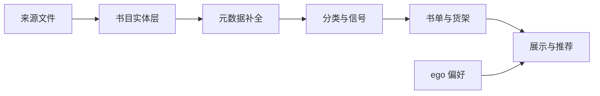

# 书城分发：商业级方案（草案，待 review）

> 目标：每本书只有一个干净的「书目实体」，元数据（尤其封面）完整可信，按权威榜单、分类、口碑、新旧和**个人偏好**分发，而不是按网盘目录名摆货架。
> 约束：界面只讲阅读，不出现格式、文件、版本、路径、体积；一本书一个文件；错误数据删掉（进废纸篓并留清单）；不删 catalog.db / ghosts / enrich；只用合规数据源。

## 1. 现状（调研结论）

| 维度 | 现状 | 问题 |
|---|---|---|
| 露出 | 首页货架只覆盖约 11% 的书 | 89% 的书只挂在来源目录上，首页和详情页都看不到 |
| 首页 | 最多 16 行，书单和套装永远轮不到 | 中文区被 15 个只有 3–6 本的豆瓣子榜占满 |
| 货架 | 950 个，93% 的挂架关系是网盘目录 | 名次多是文件编号；近似重复货架 521 对；豆瓣 TOP250 有 3 个版本；纽约时报榜停在 2025-01 |
| 中文书元数据 | 外部数据覆盖 0% | 分类靠模型看书名猜，43.7% 被归成「商业经济」；没有简介和评分 |
| 英文书元数据 | 匹配上 27.8%，评分可用的只有 7.7% | 没用 ISBN（82.8% 的书有）；补全任务已停 |
| 封面 | 只用文件自带的封面 | 没有外部封面源兜底 |
| 排序与推荐 | 完全没有 | 唯一的推荐是「同作者作品」；搜索没有相关度排序 |
| 去重 | 按现有规则，一部作品已基本只有一个文件 | 估计漏判：很可能重复 74 部，可能重复 161 部；版本和译本尚未定义 |

## 2. 数据源选择（只用合规来源）

| 用途 | 中文书 | 英文书 | 风险 |
|---|---|---|---|
| 书目、ISBN、出版信息 | **EPUB 版权页的 CIP 数据**（中图分类号、主题词、丛书、原书名、出版社、出版年） | Open Library 月度 dump（本地按 ISBN 关联） | 低 |
| 奖项、系列、体裁、作者 | Wikidata 中文标签（茅盾、鲁迅、雨果等奖） | Wikidata | 低（CC0） |
| 封面 | 文件自带 → Open Library 封面（按 ISBN，再按书名 + 作者）→ Google Books / Apple Books | 同左 | 低 |
| 简介 | Google Books；没有时由本地模型读正文生成，并标明「AI 导读」 | Open Library / Google Books / Apple Books（2026-10-18 起，见下） | 低 |
| 口碑、评分 | 豆瓣：按 ISBN 慢速查公开条目页（见第 7 节）；用户自己的豆瓣记录（ego）只在详情页显示、不计入综合分 | UCSD Goodreads 数据集（按 ISBN 对接，取作品级评分）；Open Library（按 ISBN 查） | Goodreads 数据集：学术许可，仅限个人使用、不得分发 |
| 畅销榜 | 豆瓣 TOP250 和年度榜（几百条，人工导入）；现有目录榜单清洗后保留 | 纽约时报 Books API（畅销榜历史） | 人工导入：低 |
| 出版日期（新书上架） | 豆瓣（按 ISBN，查不到再按书名、作者） | Amazon → Apple Books（公开查询接口）→ 豆瓣 | 用户 2026-10-11 明确决定允许低频自动查询 Amazon、豆瓣，接受协议风险；每个平台 2–3 秒一次，遇到验证页就暂停，不绕过 |
| 不用 | 抓 Goodreads 网页；亚马逊、豆瓣除评分和出版日期外的内容（简介、短评等） | 同左 | 违反使用协议。豆瓣评分和出版日期是例外：用户 2026-10-11 明确决定按 ISBN 慢速查，接受协议风险 |

> Apple Books（2026-10-18 起）：iTunes 公开查询接口按可信 ISBN 查，只取出版社简介和封面，详情页注明「Apple Books」并链接原页面；每 3 秒一次，403 / 429 就停；出版日期任务也查这个接口，两者错开跑。抽查 24 本中文书、译文一本都查不到，所以只查英文书。Google Books 不带 key 的共享额度一直是 429，要在 `data/config.json` 填自己的 `google_books_key` 才能用。

> 亚马逊不可用：PA-API 已停用，替代的 Creators API 要求近 30 天有 10 笔推广销售；亚马逊中国 Kindle 已停运。现有的亚马逊榜单只能沿用目录里带来的。
> 「新书上架」按出版日期排（用户 2026-10-11 决定），不再用来源目录日期；目录日期仍记在书目库里，只作参考。

## 3. 架构（六层）

| 层 | 做什么 | 存在哪 |
|---|---|---|
| 书目实体层 | ISBN 规范化与校验；书名和作者规范化（繁简、国籍括号、译者、副标题、版本词、卷号）；打分阈值匹配；低置信度进复核队列；产出「同一本书」的判定，交给去重执行 | 新库 `data/biblio.db`，以稳定的文件指纹 fid 为键，不改 catalog.db 结构 |
| 元数据补全 | 按上表的数据源逐字段补全；每个字段记录来源、来源编号和置信度；封面优先 | 同上 |
| 分类与信号 | 统一的两级分类（约 20 个大类、约 120 个小类），由中图法、BISAC、OL 主题词、Wikidata 体裁映射而来，模型兜底时读正文而不是只看书名；信号：口碑（多来源贝叶斯平均）、奖项、权威榜单、出版年、个人偏好 | 同上 |
| 书单与货架 | 目录货架去重合并成规范书单（一个豆瓣 TOP250）；榜单按家族跨期聚合，并标明年份；名次只采用来源可信的；自动生成的专题书单：作者专题、系列阅读顺序、获奖合集 | 同上 |
| 展示与推荐 | 首页模块化编排（修掉 16 行的缺陷）；详情页更丰富；相似书推荐；个性化 | store.py |
| 运营与质量 | 管理页加覆盖率看板和复核队列；增量定时任务；回归测试 | 管理页、tests |

## 4. 书城展示（改版后）

| 位置 | 模块 |
|---|---|
| 首页·个人 | 你想读的书已在书库（ego 想读清单 482 本）；为你推荐（按喜欢的作者和题材）；读过中文版，试试英文原版；外刊专区（经济学人、时代周刊等） |
| 首页·公共 | 权威榜单（每个家族一行，标明年份）；获奖作品；新书（按出版年，「2026 年新书」由此而来）；分类频道；英文难度阶梯；编辑书单、套装 |
| 详情页 | 封面、简介（标明来源）、作者介绍、获奖、系列与阅读顺序、分类路径、口碑（标明来源）、相似书、同作者作品；已读和想读的状态（来自 ego） |
| 列表与搜索 | 相关度排序（书名、作者、简介、主题词）；拼音检索；两级分类、出版年、口碑、难度筛选 |

## 5. 分期

| 阶段 | 内容 | 用户可见的变化 |
|---|---|---|
| P0 快速见效 | 修首页 16 行缺陷；清洗货架名、合并重复书单、去掉假名次；纽约时报榜标年份；按 ISBN 补封面；解析中文书 CIP | 首页书单和套装出现；封面变多；中文书有了正确的分类和出版年 |
| P1 书目实体与去重 | 匹配管线、复核队列；合并漏判的重复；按你定的版本规则处理 | 一本书一个条目 |
| P2 元数据补全 | Wikidata、Open Library（用 ISBN）、Google Books、纽约时报；AI 导读简介 | 详情页有简介、获奖、系列 |
| P3 分类与信号 | 两级分类体系、口碑聚合、出版年 | 分类频道、新书、口碑排序 |
| P4 展示与个性化 | 首页改版、详情页、ego 偏好接入 | 为你推荐、想读到货、英文原版推荐 |
| P5 搜索与相似推荐 | 相关度搜索、拼音；本地向量做相似书 | 搜得准，「读过这本的也读」 |

## 6. 与「电脑上的电子书」会话的分工

- 不改 catalog.db 结构，新数据放进 `data/biblio.db`，以 fid 为键，不受作品编号变化影响。
- 去重继续由 `library.dedupe` 执行；本方案只提供「同一本书」的判定和复核结果。
- store.py 的货架和展示逻辑由本方案负责；对方会话不再改动这部分。
- 每个阶段动手前，先把涉及共享数据的部分发给对方对齐。

## 7. 口碑聚合（第 ① 期已实现）

| 项 | 规则 |
|---|---|
| 存储 | `data/biblio.db` 的 `ratings`（每个来源一行：原始分、满分、人数、外部编号、链接）、`tries`（查过没有）、`score`（综合口碑分与卡片显示的来源）；以 fid 为键 |
| 来源 | 豆瓣（10 分制）、Goodreads（5 分制）、Hardcover（5 分制）、Open Library（5 分制）；自己的豆瓣评分单列，只显示 |
| ISBN 与书名核对 | 正文里扫到的 ISBN 约 30% 属于别的书（书末广告页、同出版社书目），元数据里的只有约 4% 书名写法不同（按 Goodreads 数据抽查）。有元数据 ISBN 时只用它；没有时按「pdf 版权页 → 正文」的顺序用，外部来源的书名必须和我们的一致才收，不一致记为「书名不符」。每条评分记下外部书名，便于抽查 |
| 豆瓣抓取约束 | 每本一次请求、间隔 3–5 秒；如实标明是本地程序，不伪装、不走代理、不绕验证；条目页上的 ISBN 必须和查的一致；被拒绝（403/418/429、验证页）就整轮停下，查过的不重查 |
| 综合口碑分 | 各来源换成 10 分制 → 按该来源全库均分做贝叶斯平均 → 按 log(1+人数) × 置信度加权合并；人数不到显示门槛的来源不参与。只用于排序、筛选，不在页面上显示 |
| 卡片 | 中文书优先显示豆瓣，其余优先 Goodreads；人数不够不显示 |
| 详情页 | 每个来源一个徽章，带人数和原页面链接；Open Library 不写来源名 |
| 列表与首页 | 「评分」排序和没有名次的榜单都按综合口碑分；「口碑高分」筛选；首页每个语言一行「口碑之选」 |

| 待定 | 选项 |
|---|---|
| Hardcover | 代码已接入：只查还没有 Goodreads 评分的书，每次请求批量查 50 个 ISBN；等用户把个人 token 放进环境变量或 data/hardcover.token 后运行。页面上标明是 Hardcover 评分（Hardcover 允许个人和聚合使用，要求注明来源） |
